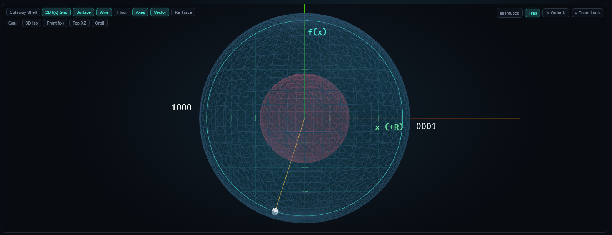
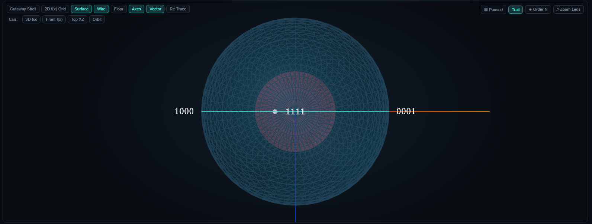

# Ramanujan's Compassion

An interactive **3D spatial-synth visualizer and IEEE-754 `float32` mathematical laboratory** uniting **Srinivasa Ramanujan's 1914 series for $1/\pi$**, **quadrature sine/cosine synthesis**, **hollow-sphere carrier geometry**, **the Four-Bit Orbit (`1000 ↔ 0001` binary palindrome & Quadray tetrahedron)**, **Morlet wavelets**, **Weierstrass fractals & elliptic curves**, and **finite-field cyclic order $N$ groups (`secp256k1`)**.

> **Core Mental Model (Audio DSP ↔ Geometry):**
> *The radius of the sphere is the sine wave.* A constant hollow sphere $V = \frac{4}{3}\pi(R^3 - r^3)$ acts as an unchanging 3D carrier vessel while internal harmonic states—2D $f(x)/x$ slices, 4-bit binary palindrome orbits, 3D analytic wavelets, Lissajous knots, and discrete order-$N$ cyclic groups—evolve inside its shell and cavity.

---

## Quick Start

Zero build tools, zero npm install, and 100% offline-ready:

1. **Direct launch:** Double-click [`index.html`](./index.html) in any modern browser (Chrome, Edge, Firefox, Safari).
2. **Optional local server:**
   ```powershell
   npx serve .
   # or: python -m http.server 8080
   ```

All 3D dependencies (`vendor/three.min.js` and `vendor/OrbitControls.js`) are vendored locally so the instrument never breaks offline.

---

## Mathematical & Audio-DSP Pillars

Detailed proofs and derivations live in [`HARMONY_ENGINE.md`](./HARMONY_ENGINE.md) and [`docs/ARCHITECTURE.md`](./docs/ARCHITECTURE.md).

### 1. Constant Hollow Sphere Vessel — $V = \frac{4}{3}\pi(R^3 - r^3)$
- **Outer Carrier ($R$)** bounds unit-amplitude quadrature oscillators ($x^2 + y^2 + z^2 = R^2$).
- **Inner Cavity ($r$)** defines a nested core (ideal for sub-carrier modulation or bounding a finite-field order-$N$ torus).
- **4-Zone Live Telemetry:** Every sample along the trajectory is vertex-colored and metered in real time as **On Sphere** ($|P| \approx R$), **In Shell** ($r < |P| < R$), **In Cavity** ($|P| < r$), or **Outside** ($|P| > R$, e.g., $\tan$ `#DIV/0!` sentinel explosions).
- **Cutaway Shell Mode (`C`):** Slices the upper hemisphere into gossamer wireframe to expose the glowing annular wall $\Delta r = R - r$ and inner red cavity bowl.

### 2. Two Distinct Twins: Antipodal ($-P$) vs. Conjugate ($\bar{P}$)
Audio engineering and complex analysis use two different symmetries that are separated explicitly in the **TWIN** selector:
- **Antipodal Twin $-P = (-x, -y, -z)$ (`−P Null`):** A 180° polarity flip on all axes. Summing $P + (-P) = 0$ is the classic mixing-console **phase-null test**.
- **Conjugate Twin $\bar{P} = (x, -y, z)$ (`P̄ Conj`):** Negates only the imaginary/quadrature $y$-axis. Summing $P + \bar{P} = (2x, 0, 2z)$ cancels the imaginary component and collapses onto the **Real Trace**—the exact mechanism behind Euler's $\cos\theta = \frac{1}{2}(e^{i\theta} + e^{-i\theta})$, analytic Morlet wavelets, short Weierstrass point negation $(x, y) + (x, -y) = \mathcal{O}$, and Frobenius trace point counting.

### 3. The Four-Bit Orbit (`1000 ↔ 0001` Binary Palindrome & Quadray Sphere) (`B`)
- **Binary Palindrome Hinge on the X-Axis:** The **Front $f(x)$ ($XY$) plane** ($z = 0$) and the **Top $XZ$ plane** ($y = 0$) intersect along the **X-axis**, touching the sphere of radius $R$ at two exact antipodal points representing the 4-bit binary palindrome pair **8 (`1000₂`)** and **1 (`0001₂`)**:
  $$(-R, 0, 0) = \mathbf{1000_2\ (8)} \qquad \longleftrightarrow \qquad (+R, 0, 0) = \mathbf{0001_2\ (1)}$$
- **Front $f(x)$ Meridian Orbit vs. Top $XZ$ Equatorial Orbit:**
  - In **Front $f(x)$** view, `1000` ($8$) and `0001` ($1$) orbit in harmony around the sphere's vertical meridian $(-R\cos\theta, -R\sin\theta, 0) \leftrightarrow (+R\cos\theta, +R\sin\theta, 0)$, sweeping between the **North Pole `+Y` = `1111 / F` ($15$, max 4-bit nibble)** at the top and the **South Pole `−Y` = `0000` ($0$)** at the bottom.
  - In **Top $XZ$** view (looking straight down $+Y$), **`1111 / F`** crowns the exact center of the sphere (with `0000` at the nadir underneath), while the 3D sphere geometry allows `1000` ($8$) and `0001` ($1$) to continue a physically valid circular orbit around the horizontal $XZ$ equator $(-R\cos\theta, 0, -R\sin\theta) \leftrightarrow (+R\cos\theta, 0, +R\sin\theta)$—phase-locked to the exact same real coordinate $x = \pm R\cos\theta$!
- **Inscribed Quadray Tetrahedron:** Inside the sphere sit the 4 tetrahedral Quadray basis vectors radiating from the origin `(0,0,0,0)` (`0000`):
  $$D = (0,0,0,1) \equiv \text{0001}_2,\quad C = (0,0,1,0) \equiv \text{0010}_2,\quad B = (0,1,0,0) \equiv \text{0100}_2,\quad A = (1,0,0,0) \equiv \text{1000}_2$$
  whose combined 4-bit state is $(1,1,1,1) = \mathbf{1111_2\ (\text{0xF} = 15)}$.

| Front $f(x)$ View (`1000 ↔ 0001` Meridian Orbit) | Top $XZ$ View (`1111 / F` Center & Equatorial Orbit) |
| :---: | :---: |
|  |  |

### 4. Inscribed 2D $f(x)/x$ Slice & Circular `float32` Zoom Lens (`Z`)
- Inside the 3D sphere at $z = 0$ sits an inscribed Cartesian $f(x)/x$ scope dial (`2D f(x) Grid`, `F` camera snap).
- Plot **Weierstrass's fractal** $W(x) = \sum_{k=0}^{K} a^k \cos(b^k \pi x)$, the **Short Weierstrass elliptic curve** $y^2 = x^3 + 7$ (`secp256k1`'s real slice), **Fourier odd-harmonic square waves**, or **2D Gabor/Morlet atoms** directly inside the sphere.
- Toggle the **Zoom Lens (`Z`)** to inspect fractal self-similarity or Gibbs ringing at **$4\times$ to $256\times$** magnification—genuinely re-evaluating `Harmony.engine` in `float32` inside the red callout ring rather than upscaling pixels.

### 5. Discrete Order $N$ Strobe (`N`) & Frobenius `secp256k1`
- **Order $N$ Strobe:** Quantizes any continuous curve into $N$ discrete group steps $P_0, P_1, \dots, P_{N-1}$ with generator hop stride $n$:
  - When **$\gcd(n, N) = 1$** (always true for **prime $N$**, cofactor $1$), generator chords visit all $N/N$ points before closing.
  - When **$\gcd(n, N) > 1$** (composite $N$), the orbit collapses into a smaller subgroup $N / \gcd(n, N)$, leaving inactive coset points dimmed.
- **Tab 3 — Frobenius & Hasse:** Computes exact 256-bit `BigInt` Lucas recurrences $S_k = \lambda^k + \bar{\lambda}^k$ for the real cryptographic curve **`secp256k1`**, demonstrating how conjugate phasors on the Hasse circle of radius $\sqrt{p}$ determine exact finite-field point counts $\#E(\mathbb{F}_{p^k}) = p^k + 1 - S_k$.

### 6. Ramanujan's 1914 $1/\pi$ Series & IEEE-754 `float32` Bit Lab
$$
\frac{1}{\pi} = \frac{2\sqrt{2}}{9801} \sum_{k=0}^{\infty} \frac{(4k)!\,(1103 + 26390k)}{(k!)^4\, 396^{4k}}
$$
- Standard 32-bit audio float (`float32`) has 24 significand bits (~**144.5 dB** dynamic range), representing $\pi$ as hex `0x40490FDB` (`3.14159274`).
- While Leibniz/Gregory Fourier series require **millions of harmonics** to lock 24 bits of $\pi$, Ramanujan's modular-form series drops **~208 dB (~8 decimal digits) per term**—locking all 32 bits of `0x40490FDB` on the **$k = 0$ fundamental alone** (inspectable bit-for-bit in **Tab 2** and **Tab 4**).

---

## Curated Patch Library

| Category | Patch Preset | Highlights |
| :--- | :--- | :--- |
| **Sphere & Carrier** | **Four-Bit Orbit — `1000 (8) ↔ 0001 (1)` Palindrome & Quadray** | Dual Meridian ($XY$) & Equatorial ($XZ$) 4-bit palindrome orbit, `1111/F` top pole, `0000` bottom pole & inscribed Quadray tetrahedron |
| **Sphere & Carrier** | **Great Circle — 90° Quadrature Carrier** | Pure $\cos/\sin$ quadrature on the outer sphere $x^2 + y^2 = R^2$ |
| **Sphere & Carrier** | **Hollow Shell Carrier — 3D Radial Wavetable ($R^3 - r^3$)** | Spherical wavetable breathing between inner cavity $r$ and outer carrier $R$ |
| **Sphere & Carrier** | **Ellipse — Sub-Carrier Inside Shell** | Unequal quadrature amplitudes oscillating between the shell and cavity |
| **2D $f(x)$ Slice** | **Weierstrass Fractal — Internal 2D $f(x)$ Slice** | $W(x) = \sum a^k \cos(b^k \pi x)$ with $4\times\text{–}256\times$ `float32` Zoom Lens |
| **2D $f(x)$ Slice** | **Weierstrass Curve $y^2 = x^3 + 7$ — `secp256k1` 2D Slice** | Elliptic curve real locus with Conjugate Twin point negation & Order $N$ strobe |
| **2D $f(x)$ Slice** | **Morlet Wavelet $\Psi(x)$ — 2D Gabor Slice** | Gaussian-windowed cosine atom on the internal $f(x)$ scope dial |
| **2D $f(x)$ Slice** | **Fourier Square Wave — Odd Harmonics $K$** | Additive synthesis of odd harmonics $1/(2k+1)$ with Gibbs ringing inspection |
| **3D Wavelets & Knots** | **Analytic Morlet $\psi(t)$ — 3D Conjugate Helix** | Complex 3D wavelet helix whose conjugate sum $(\psi + \bar{\psi})/2$ collapses to real $\Psi(t)$ |
| **3D Wavelets & Knots** | **Lissajous 3D Harmonic Knot ($n : m : k$)** | Integer frequency ratios weaving a closed 3D knot through the vessel |
| **3D Wavelets & Knots** | **Finite Field Torus Knot — Order $N$ Cavity** | Modulo-wrapped 3D torus nested strictly inside the inner $N$-cavity ($|P| < r$) |
| **Sentinels** | **Sawtooth Wrap — Finite Modulo ($\pm 1$)** | Clean hardware-style phase accumulator reset via `saw()` modulo |
| **Sentinels** | **TANGENT — The `#DIV/0!` Sentinel Explosion** | $\tan(2\pi t)$ escaping the sphere toward IEEE-754 $\pm\infty$ (`0x7F800000`) |
| **Custom** | **Custom Formula Patch** | Live whitelisted `float32` equation patch bay for arbitrary $x(t), y(t), z(t)$ |

---

## VST-Style `A | B | C` Sphere Bank

Located at the top of the left Synth Rack, modeled after hardware/VST synthesizers and reference analyzers:

- **`A` / `B` / `C` Slots:** Hold three independent sphere + patch snapshots (preset, custom formulas, $R$, cavity $r$, Order $N$, oscillator sliders, twin mode, cutaway, 4-Bit Orbit, and lens settings).
- **Live Auto-Save:** Any slider or patch tweak automatically updates the active slot.
- **`Copy →`:** Click `Copy →`, then click a destination slot (`A`, `B`, or `C`) to clone your current patch so you can sculpt variations safely.
- **`Ghost` Reference Overlay (`G`):** Renders the previous/copied slot's curve as a subtle violet reference trajectory simultaneously inside the **3D Hollow Sphere**, **2D Slice Scope**, and **Dual Oscilloscope**.
- **`Share Link`:** Encodes the active patch snapshot into a self-contained `#patch=...` URL hash.

---

## Studio Keyboard Shortcuts

| Key | Action |
| :--- | :--- |
| `Space` | Play / Pause oscillator transport |
| `1` `2` `3` `4` | Switch bottom Studio Dock tabs (*Scopes*, *Harmonics & Ramanujan*, *Frobenius & Hasse*, *Float32 Bit Lab*) |
| `Alt+1` `Alt+2` `Alt+3` | Jump directly to Sphere Slot **A**, **B**, or **C** |
| `[` / `]` | Cycle backward / forward through Sphere Slots **A ↔ B ↔ C** |
| `B` | Toggle **Four-Bit Orbit (`1000 ↔ 0001` Palindrome & Quadray Sphere)** |
| `G` | Toggle **Ghost** reference trajectory overlay across 3D & 2D scopes |
| `C` | Toggle **Cutaway Shell** ($V = \frac{4}{3}\pi(R^3 - r^3)$ cross-section) |
| `N` | Toggle **Discrete Order $N$ Strobe** |
| `Z` | Toggle **Circular `float32` Zoom Lens** |
| `F` | Snap 3D camera straight onto the internal **Front 2D $f(x)$** slice plane |
| `Double-click slider` | Reset any parameter slider to its preset default |

---

## Repository Structure

```text
Ramanujan Sphere/
├── index.html              # Zero-scroll 100dvh studio shell (Synth Rack + 3D Stage + 4-Tab Dock)
├── HARMONY_ENGINE.md       # Mathematical & DSP derivations (Phasors, Morlet, Frobenius, 4-Bit Orbit, Float32)
├── README.md               # Quick start, mathematical pillars, preset catalog, and keyboard shortcuts
├── docs/
│   ├── ARCHITECTURE.md     # Module boundaries, Float32 contract, and bloat-free extension guide
│   ├── 4bitOrbit.png       # Reference diagram: Front f(x) view of the 1000 (8) ↔ 0001 (1) orbit
│   └── 4bitOrbitTop.png    # Reference diagram: Top XZ view with 1111/F apex and 8 ↔ 1 equatorial orbit
├── css/
│   └── styles.css          # Dark hardware-synth theme & CSS custom properties
├── js/
│   ├── engine.js           # Single Source of Truth IEEE-754 float32 math, 4-Bit Orbit & BigInt Frobenius core
│   ├── presets.js          # Curated 2D/3D spatial-synth, 4-Bit Orbit, fractal, wavelet & finite-field patches
│   ├── scene3d.js          # Three.js Hollow Sphere, 2D z=0 slice, 4-Bit Orbit/Quadray, twins, ghost & Order N
│   ├── magnifier2d.js      # Circular 4x–256x float32 re-sampling fractal/harmonic zoom lens
│   ├── lissajous2d.js      # 2D XY quadrature scope with offscreen cache, phosphor trail & strobe
│   ├── timeseries.js       # Dual-channel x(t) & y(t) oscilloscope with ±R / ±r rails & ghost trace
│   ├── harmonics2d.js      # Harmonic partial spectrum + Ramanujan 1/π vs Fourier convergence plot
│   ├── frobenius.js        # Frobenius conjugate phasors & secp256k1 Hasse trace chart
│   ├── views.js            # Namespace aggregator & verification contract surface
│   └── app.js              # Declarative state, VST A/B/C slot bank, URL hash sharing & 60fps loop
└── vendor/
    ├── three.min.js        # Vendored Three.js r128 (offline-safe)
    └── OrbitControls.js    # Vendored OrbitControls
```

---

## Agent Interface (deeplinks · bridge · CLI · MCP)

The instrument doubles as an **agent-operable tool**. The maths is unchanged — an additive
agent layer wraps the same `float32` engine and exposes the instrument over four surfaces,
all backed by one shared core (`js/engine.js` + `js/agent-core.js`):

| Surface | How an agent uses it |
| :--- | :--- |
| **Deeplink + static state** | A URL reproduces the exact view (`?preset=5&tab=harmonics&static=1` = Analytic Morlet 3D helix on the spectrum tab), and the page always publishes its state as JSON in `<pre id="ramanujan-sphere-state" hidden>` (`?static=1` is the reproducible-screenshot contract). |
| **In-page bridge** | `window.ramanujanSphere` exposes `getState()`, setters (`setState`, `setTab`, `setClock`, `step`), pure `call(tool, args)`, `getDeeplink()`, `subscribe()` and a readiness marker (`body[data-agent-ready="true"]`). |
| **Node CLI** | `node agent/cli.mjs <tool> --json` prints exactly one deterministic envelope (nine pure tools: `manifest`, `build_deeplink`, `analyze_patch`, `eval_point`, `bit_inspect`, `discrete_group`, `ramanujan_pi`, `fourbit_orbit`, `frobenius_secp`), plus `state`, `artifacts [--check]` and `selftest`. Exit codes: `0` ok · `2` usage · `3` tool error · `4` internal. |
| **MCP stdio server** | `node agent/mcp-server.mjs` speaks newline-delimited JSON-RPC 2.0 (`initialize`, `tools/list`, `tools/call`) with zero dependencies; point any MCP client at the absolute script path. |

A fifth **`5 · Agent`** dock tab makes the layer legible to humans: bridge status, the current
deeplink with a copy button, a copyable handoff prompt, live state JSON, the tool catalogue and
links to the docs and manifest.

```powershell
python -m http.server 8080 --bind 127.0.0.1     # then http://127.0.0.1:8080/
node agent/cli.mjs manifest --json               # discover tools, presets, deeplink defaults
node agent/cli.mjs bit_inspect --value 3.141592653589793 --json   # -> hex 0x40490FDB
```

Start with [`AGENTS.md`](./AGENTS.md) (LLM onboarding and troubleshooting), the normative
contract in [`docs/AGENT-INTERFACE.md`](./docs/AGENT-INTERFACE.md), and the generated
machine-readable manifest at [`agent/manifest.json`](./agent/manifest.json). The honest
cross-tool map (sibling quadray/IVM tools and planned handoffs) is
[`docs/ECOSYSTEM-MAP.md`](./docs/ECOSYSTEM-MAP.md); `llms.txt` is the short index.

Acceptance (see [`docs/AGENT-INTERFACE.md`](./docs/AGENT-INTERFACE.md) §12 for the full list):

```powershell
node --test
node scripts/gen-agent-artifacts.mjs --check
node agent/selftest.mjs
```
