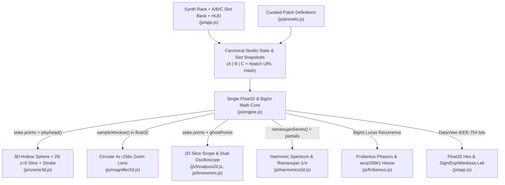

# Architecture & Extension Guide

This document explains how **Ramanujan Sphere × Harmony Engine** is structured so new mathematical experiments, presets, and audio/DSP modules can be added cleanly **without HTML or CSS bloat**.

---

## 1. Core Architectural Invariants

### A. Single Source of Truth (`float32` Engine Contract)
- **All math lives in [`js/engine.js`](../js/engine.js)** (`window.Harmony.engine`, `window.Harmony.PRECISION === 'float32'`).
- Every formula evaluation (`x(t)`, `y(t)`, `z(t)`), built-in DSP primitive (`weierstrass`, `morlet`, `fourierSquare`, `cbrt`, `saw`), and twin derivation (`antipodal`, `conjugate`, `realTrace`) is rounded through `Math.fround()` so JavaScript's 64-bit `Number` behaves identically to a 32-bit audio DSP buffer (`Float32Array`).
- **No view computes its own curve math.** Every 3D and 2D renderer consumes `state.points` and `Engine.playhead(state, points, playT)`.
- **Live Cross-View Agreement (`window.__agree`):** On every animation frame, [`js/app.js`](../js/app.js) verifies that the exact `float32` coordinates rendered by the 3D Sphere (`__scene3dPoint`), 2D Slice Scope (`__lissCross`), and IEEE-754 Bit Lab (`__bitPoint`) match bit-for-bit.

### B. Zero-Scroll `100dvh` Studio Layout
To prevent vertical page creep as features grow, [`index.html`](../index.html) and [`css/styles.css`](../css/styles.css) enforce a fixed viewport studio grid:
1. **Top Header (`46px`):** Identity badge, 4-zone color legend, and global **TWIN** mode switch.
2. **Left Synth Rack (`306px`, independently scrollable if needed):** VST `A|B|C` Sphere Bank, Preset selector, Hollow Sphere Vessel controls ($R$, $r$, Order $N$), Oscillator/Harmonic sliders, and collapsible Patch Bay equations.
3. **Hero 3D Stage (`flex: 1`):** Three.js Hollow Sphere canvas with lightweight floating HUD pills and optional circular Zoom Lens overlay.
4. **Tabbed Studio Dock (`228px`):** Houses four specialized 2D instrument bays (*1 · Scopes & Slice*, *2 · Harmonics & Ramanujan*, *3 · Frobenius & Hasse*, *4 · Float32 Bit Lab*)—only the active tab renders each frame.

### C. Zero-Build `file://` Portability
- Scripts load via classic `<script defer src="...">` tags under a single `window.Harmony` namespace rather than bare ES module imports, avoiding browser `file://` CORS restrictions when opening [`index.html`](../index.html) directly from disk.

---

## 2. Module Dataflow



---

## 3. Module Responsibilities

| File | Namespace | Responsibility |
| :--- | :--- | :--- |
| [`js/engine.js`](../js/engine.js) | `Harmony.engine` | Whitelisted formula compiler/validator, `float32` trajectory sampler (`sample`, `sampleWindow`), Hollow Sphere volume/zone metrics (`shellMetrics`, `classifyZone`), twin transforms, Ramanujan $1/\pi$ series (`ramanujanSeries`), discrete cyclic group builder (`discreteGroup`), 256-bit `BigInt` `secp256k1` Frobenius engine, and `DataView` IEEE-754 bit extractor (`bitInspect`). |
| [`js/presets.js`](../js/presets.js) | `Harmony.Presets` | Pure declarative array of patches (`name`, `group`, `formulas`, `params`, `hints`, `note`). Automatically grouped into `<optgroup>` menus by `app.js`. |
| [`js/scene3d.js`](../js/scene3d.js) | `Harmony.Scene3D` | Three.js WebGL renderer: Outer Sphere $R$, Inner Cavity $r$, Cutaway cross-section, inscribed $z=0$ Cartesian $f(x)/x$ slice plane, 4-zone vertex-colored curve, Antipodal & Conjugate twins, VST Ghost reference curve, Discrete Order $N$ 3D nodes/chords, and camera presets. |
| [`js/magnifier2d.js`](../js/magnifier2d.js) | `Harmony.Magnifier2D` | Floating circular zoom callout ($4\times$–$256\times$) that re-samples `Engine.sampleWindow` in `float32` around the trough, origin, or live playhead. |
| [`js/lissajous2d.js`](../js/lissajous2d.js) | `Harmony.Lissajous2D` | 2D XY quadrature & $f(x)$ slice scope with offscreen static canvas caching, fading phosphor trail, twins, Ghost reference curve, and 2D Order $N$ strobe projection. |
| [`js/timeseries.js`](../js/timeseries.js) | `Harmony.TimeSeries` | Dual-channel $x(t)$ & $y(t)$ oscilloscope with $\pm R$ / $\pm r$ rails, twin traces, Ghost reference wave, optional `saw`/`tan` reference overlays, and playhead cursor. |
| [`js/harmonics2d.js`](../js/harmonics2d.js) | `Harmony.Harmonics2D` | Left: Harmonic partial amplitude analyzer ($k = 0..K$). Right: Ramanujan $1/\pi$ vs. Gregory-Leibniz dB error convergence against the `float32` noise floor (`-144.5 dB`). |
| [`js/frobenius.js`](../js/frobenius.js) | `Harmony.Frobenius` | Left: Conjugate Frobenius eigenvalues $\lambda^k, \bar{\lambda}^k$ on the normalized Hasse circle. Right: Normalized Hasse trace $2\cos(k\phi) \in [-2, +2]$ across $k = 1..16$. |
| [`js/views.js`](../js/views.js) | `Harmony.views` | Aggregates view modules into a single inspection surface (`Harmony.views`). |
| [`js/app.js`](../js/app.js) | `Harmony.App` | Declarative `PARAM_DEFS` slider binding, canonical `captureSnapshot` / `applySnapshot` serializer powering both **VST `A/B/C` Sphere Slots** and `#patch=` URLs, dock tab routing, keyboard shortcuts, and the 60 fps `requestAnimationFrame` orchestrator. |

---

## 4. Extending the Instrument Without Bloat

### Recipe 1: Add a New Patch Preset (Zero HTML/CSS edits)
Append an entry to `PRESETS` in [`js/presets.js`](../js/presets.js):
```javascript
{
  name: 'My New Harmonic Patch',
  group: '3D Wavelets & Knots', // Reuses existing <optgroup> or creates a new one automatically
  formulas: {
    x: 'r*cos(TAU*n*t)',
    y: 'r*sin(TAU*m*t+phase)',
    z: 'rIn*sin(TAU*k*t)'
  },
  params: { r: 1.2, rIn: 0.5, amp: 1, f: 1, n: 5, m: 3, k: 2, K: 6, orderN: 23, a: 0.5, b: 3, phaseDeg: 0 },
  hints: { sliceGrid: false, cutaway: true, magnifier: false, twinMode: 'conjugate', strobeN: false },
  note: 'Short description shown in the green Patch Note readout.'
}
```
Both the dropdown, double-click slider defaults, URL `#patch` sharing, and `A/B/C` slots support it automatically.

### Recipe 2: Add a New Math / DSP Function to the Formula Patch Bay
In [`js/engine.js`](../js/engine.js):
1. Implement the `float32`-rounded function (wrapping inputs/outputs with `f32 = Math.fround`).
2. Add its identifier string to `WHITELIST` (the security/validation allowlist for user formulas).
3. Register its implementation in `SCOPE_KEYS` / `SCOPE_VALS` so `compileAxis` exposes it inside `x(t)`, `y(t)`, and `z(t)` expressions.

### Recipe 3: Add Real-Time WebAudio Synthesis (Future Roadmap)
Because `Harmony.engine` already evaluates bounded `float32` quadrature trajectories `(x(t), y(t), z(t))`:
- Create a standalone `js/audio.js` (`Harmony.Audio`) module with an `AudioWorklet` or stereo `ScriptProcessor` / wavetable `PeriodicWave` builder.
- Map `x(t)` → Left (`cos` I-channel) and `y(t)` → Right (`sin` Q-channel) for true stereo quadrature / Lissajous vector synthesis, clipped softly at outer sphere radius $R$.
- Wire a single mute/unmute transport pill in `.hud-right` without altering any existing panel geometry.

### Recipe 4: Migrating to TypeScript / Vite Later (Optional)
If the project ever outgrows classic `<script>` tags:
- Each IIFE in `js/*.js` already has a 1-to-1 module boundary with explicit inputs (`state`, `points`, `playT`).
- Replace `window.Harmony.X = ...` with `export const X = ...` while keeping `engine.ts` pure and dependency-free.
