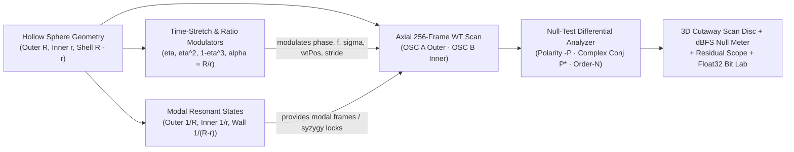
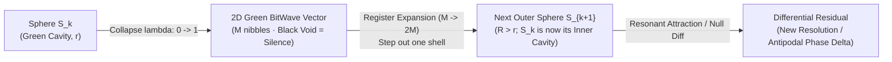

# DRAFT Design Spec — Dual-Sphere Time-Stretch, Modal Resonance & 256-Frame Wavetable Null-Test Analysis

> **Status:** `DRAFT — CHRONOLOGICAL ITERATIVE DESIGN SPEC (REAL GUI)`
>
> **How to use this document:** This is an **iterative, chronological specification** meant to evolve directly inside the existing **The Ramanujan Chime** GUI (`index.html`, `js/engine.js`, `js/scene3d.js`, `js/app.js`, and its existing studio scopes/cutaway sphere/4-Bit Orbit)—**never** as a detached standalone spike page. Work through the document **in chronological order** (§1 → §2 → §3 → §4 → §5 → §5.5 → §5.6 → §5.7), proving and integrating each layer visually inside the real instrument before layering the next, while weighing the §6 constraint trade-offs honestly along the way.

---

## 1. Core Thesis: Both Spheres Are Active Objects

In the current instrument, the outer sphere ($R$) and inner cavity ($r$, `rIn`) act primarily as a static vessel $V_{\text{shell}} = \frac{4}{3}\pi(R^3 - r^3)$ and a 4-zone boundary classifier (`ON SPHERE`, `IN SHELL`, `IN CAVITY`, `OUTSIDE`).

This spec elevates **both the outer sphere and the inner cavity into active, first-class geometric and modal objects**—independent of whatever trajectory is drawn inside them:

1. **Outer Sphere ($R$) — `OSC A`:** Always active, whether the inner cavity is enabled ($r > 0$) or disabled ($r = 0$, solid ball).
2. **Inner Cavity ($r$) — `OSC B`:** Optional nested object ($0 < r < R$). When enabled, it acts as a second coupled resonator and a second 256-frame axial wavetable oscillator that can be differential-tested against `OSC A`.
3. **Hollow Shell Annulus ($\Delta = R - r$):** The coupled space *between* the two objects—whose compression/expansion behaves mathematically like a DAW time-stretcher and acts as a **modulation source** for the entire synthesizer.



---

## 2. Sphere Expansion as DAW Time-Stretching (Modulation Source)

### 2.1 The Constant-Volume Stretch Law

The hollow vessel volume is:

$$V_{\text{shell}} = \frac{4}{3}\pi(R^3 - r^3)$$

Define the dimensionless cavity-to-carrier ratio:

$$\eta = \frac{r}{R} \in [0, 1)$$

Suppose the shell holds a **constant volume** $V_0 = \frac{4}{3}\pi R_0^3$ (an incompressible vessel), and we expand the inner cavity $r \to \infty$. To conserve volume, the outer radius must grow as:

$$R(r) = \left(r^3 + R_0^3\right)^{1/3}$$

Differentiating with respect to $r$ gives the instantaneous expansion rate (the **radial Jacobian**):

$$\frac{dR}{dr}\Big|_{V=\text{const}} = \left(\frac{r}{R}\right)^2 = \eta^2$$

Notice what happens as $r$ expands toward $\infty$:
- **Surface area** expands quadratically ($4\pi r^2 \to \infty$).
- **Wall thickness** compresses inversely ($\Delta(r) = R(r) - r \approx \frac{R_0^3}{3r^2} \to 0$).
- **Total shell volume** remains invariant ($V_{\text{shell}} = V_0$).

### 2.2 Why This Matches DAW Time-Stretching & Morlet Wavelets

In a DAW (phase vocoder, granular stretch, or constant-$Q$ wavelet transform), stretching a sample by a factor $\alpha$ spreads its time duration while conserving energy/area under the time-frequency box:

$$\psi_{a,b}(t) = \frac{1}{\sqrt{a}}\,\psi\!\left(\frac{t - b}{a}\right), \qquad \Delta t \cdot \Delta \omega = \text{const}$$

In Preset 5 (`Analytic Morlet ψ(t)`), stretching the Gaussian window width $\sigma \mapsto \alpha \sigma$ while holding the carrier frequency $\omega_0$ fixed is literally **pitch-locked DAW time-stretching** (more wave cycles fit inside a wider envelope). Coupling $\omega_0 \mapsto \omega_0 / \alpha$ is **tape-style resampling** (pitch drops as duration stretches).

### 2.3 Geometric Modulation Outputs

Because $R$ and $r$ are already live parameters in `Harmony.engine`, their geometry immediately yields four normalized modulation sources that can patch into any synth destination (`phase`, `f`, Morlet $\sigma$, `wtPos`, `orderN` stride, or `amp`):

| Mod Source | Formula | Range | Musical / DSP Character |
| :--- | :--- | :--- | :--- |
| `mod_eta` | $\eta = r / R$ | $[0, 1)$ | Linear macro sweep from solid ball ($0$) to thin bubble ($\to 1$). |
| `mod_area` | $\eta^2 = A_{\text{in}} / A_{\text{out}} = dR/dr\big\|_V$ | $[0, 1)$ | Exponential-feeling warp curve; exact rate of constant-volume expansion. |
| `mod_vol` | $1 - \eta^3 = V_{\text{shell}} / V_{\text{outer}}$ | $(0, 1]$ | Fraction of sphere energy remaining in the shell wall; smooth knee near $0$, steep drop near $1$. |
| `mod_stretch` | $\alpha = R / r = 1/\eta$ (log-mapped: $\log_2(R/r)$ octaves) | $[0, \infty)$ octaves | Literal time-stretch ratio! Using $\log_2(R/r)$ gives **musical octaves** (e.g., $R=1, r=0.5 \Rightarrow +1.0\text{ oct}$; $r \to 0$ cleanly clamps or disables inner coupling without hitting `Infinity` / `0x7F800000`). |

> **Practical note on "infinite expansion":** In floating-point hardware, letting $r \to \infty$ directly overflows `float32` (`FLT_MAX` $\approx 3.4 \times 10^{38}$). Expressing the stretch modulator in **dimensionless ratios** ($\eta \in [0, 1)$ or $\log_2(R/r)$ octaves) lets you explore the entire infinite-expansion regime smoothly without numerical blow-up—while optionally still allowing raw unbounded $r$ when deliberately testing IEEE-754 sentinels.

---

## 3. Geometric & Modal Resonant States of Each Sphere

Treating the spheres as 3D acoustic/electromagnetic resonators ($\nabla^2 \Psi + k^2 \Psi = 0$ in spherical coordinates) yields clean, exact resonant states with zero guesswork:

### 3.1 Three Coupled Radial Resonant Ladders ($\ell = 0$ Breathing Modes)

For spherically symmetric radial modes, the spherical Bessel function reduces to a pure sinc wave $j_0(k\rho) = \frac{\sin(k\rho)}{k\rho}$, giving **exact harmonic integer ladders**:

1. **Outer Sphere Mode ($r = 0$ or global carrier):**
   $$k_q^{\text{out}} = \frac{q\pi}{R} \qquad (q = 1, 2, 3, \dots)$$
2. **Inner Cavity Mode ($0 \le \rho \le r$):**
   $$k_q^{\text{in}} = \frac{q\pi}{r} = \frac{R}{r}\,k_q^{\text{out}} = \alpha\,k_q^{\text{out}}$$
3. **Hollow Shell Wall Mode ($r \le \rho \le R$):**
   $$k_q^{\text{shell}} = \frac{q\pi}{R - r} = \frac{k_q^{\text{out}}}{1 - \eta}$$

**Concrete Musical Example:**
- Set $R = 1.0$, $r = 0.5$ ($\eta = 0.5$, $\alpha = 2.0$):
  - Outer fundamental = $1\times$ (root).
  - Inner fundamental = $2\times$ (**exact octave above**).
  - Shell wall thickness $\Delta = 0.5 \Rightarrow$ wall fundamental = $2\times$ (**triple harmonic lock**—inner cavity and shell wall share the exact same resonant frequency!).
- Set $R = 1.0$, $r = 0.75$ ($\eta = 0.75$, $\alpha = 4/3$):
  - Inner cavity sits a **perfect fourth** ($4:3$) above the outer sphere.
  - Shell wall thickness $\Delta = 0.25 \Rightarrow$ wall mode jumps **two octaves** ($4\times$) above the outer sphere.
- Set $R = 1.0$, $r = 0.45$ (the app's current default):
  - $\alpha = 20/9 \approx 2.222$ — detuned from an octave by $+182.4$ cents, creating slow **modal beating** between the outer and inner spheres.

### 3.2 Angular Resonant Modes ($Y_\ell^m$)
Non-radial standing waves wrap around latitude and longitude via spherical harmonics $Y_\ell^m(\theta, \phi)$, indexed by degree $\ell$ and azimuthal order $m$. These pair directly with the existing `n`, `m`, `k` harmonic controls and Order-$N$ cyclic symmetries.

### 3.3 Archimedes' Constant-Area Slice Theorem (Why Axial WT Scanning Works So Cleanly)

Slice both concentric spheres perpendicular to the scan axis (say $z$, matching Preset 5's Cutaway Morlet):

- Outer circle radius at slice $z$: $\rho_{\text{out}}(z) = \sqrt{R^2 - z^2}$ for $|z| \le R$
- Inner circle radius at slice $z$: $\rho_{\text{in}}(z) = \sqrt{r^2 - z^2}$ for $|z| \le r$

Inside the inner cavity span ($-r \le z \le +r$), the cross-sectional area of the hollow shell ring is:

$$A_{\text{ring}}(z) = \pi\big(\rho_{\text{out}}^2(z) - \rho_{\text{in}}^2(z)\big) = \pi\big((R^2 - z^2) - (r^2 - z^2)\big) = \pi(R^2 - r^2)$$

The $z^2$ terms **cancel identically**. As a wavetable position knob scans across the inner cavity ($[-r, +r]$), the shell ring has **strictly constant cross-sectional area** (flat geometric energy), then tapers parabolically $\pi(R^2 - z^2)$ in the polar caps $|z| \in (r, R]$.

---

## 4. Dual-Sphere 256-Frame Wavetable Oscillator Model

Modeled directly on Serum 2 and Vital:
- **Table depth:** $F = 256$ frames (`0..255`, or `0x00..0xFF` — two 4-bit nibbles, naturally aligned with the Four-Bit Orbit architecture).
- **Frame length:** $L$ samples per single-cycle waveform (`256` for fast real-time preview, `2048` for Serum/Vital-grade fidelity, or `N` when quantized to an Order-$N$ cyclic ring).
- **WT Position Knob (`wtPos` $\in [0, 1]$):** Maps directly to axial position $z = \text{lerp}(-R, +R, \text{wtPos})$ along the cutaway sphere's spine.

### 4.1 Scan Mapping: Outer (`OSC A`) and Inner (`OSC B`)

- **Outer WT Oscillator (`OSC A`, radius $R$):**
  Always defined for $z \in [-R, +R]$ (works whether inner cavity is enabled or disabled):
  $$p_A(z) = 255 \cdot \frac{z + R}{2R}$$

- **Inner WT Oscillator (`OSC B`, radius $r > 0$):**
  Active when $|z| \le r$ (with optional wrap/clamp outside $|z| > r$), supporting two coupling modes:
  1. **`local` (Time-Stretched Scan):** Maps $[-r, +r]$ across all 256 frames:
     $$p_B^{\text{local}}(z) = 255 \cdot \frac{z + r}{2r}$$
     Because $[-r, +r]$ is narrower than $[-R, +R]$ by factor $\alpha = R/r$, sweeping the global `wtPos` knob scans `OSC B` **$\alpha$ times faster** than `OSC A`—literal wavetable time-compression inside the inner cavity.
  2. **`world` (Windowed / Sub-Range Scan):** Shares the global frame index $p_B^{\text{world}}(z) = p_A(z)$ gated to $|z| \le r$, isolating only the central $\eta$-fraction of frames:
     $$p_B \in \big[\,127.5(1 - \eta),\; 127.5(1 + \eta)\,\big]$$

### 4.2 What Lives Inside the 256 Frames? (Three Candidate Frame Generators)

We should support (or choose among) three clear ways to populate the 256 frames:

1. **Spatial Axial Slice (`slice`):** Frame $f$ captures the cross-sectional waveform / complex phasor profile at axial coordinate $z(f)$ (e.g., slicing the 3D Analytic Morlet helix, a Lissajous knot, or a radial/angular Bessel mode along $z$).
2. **Order-$N$ Differential Table (`orderN`):**
   - `OSC A` holds the continuous reference cycle (or full Order-$N$ basis) at frame $f$.
   - `OSC B` holds the **Order-$N$ quantized / stride-$g$ cyclic subgroup** reconstruction (`discreteGroup` in `js/engine.js`).
   - Variants to test during brainstorm:
     - *Variant 2a (Fixed $N$, spatial sweep):* $N$ and stride $g$ are fixed while frames `0..255` sweep the axial coordinate $z$ (or phase/frequency) to see *where* Order-$N$ aliasing peaks.
     - *Variant 2b (Order-$N$ Ladder):* Frame index $f$ itself steps across cyclic orders (e.g., $N = 3 \dots 258$, or stride $g = 1 \dots N$) so turning `wtPos` literally auditions **prime vs. composite Order-$N$ resonances**!
3. **Harmonic / Parameter Morph (`morph`):** Frame $f$ sweeps harmonic depth $K$, Weierstrass roughness $a$, or Morlet dilation $\sigma(f)$ across `0..255`—a classic additive/wavelet wavetable.

---

## 5. Null-Test Differential Analysis

In audio engineering, a null test adds a polarity-inverted copy of Signal B to Signal A: $\Delta = A + (-B) = A - B$. Everything identical cancels to digital silence; whatever survives is the **exact structural difference**.

`The Ramanujan Chime` already has the exact two twins needed to make this deeper than a plain scalar subtraction:
- **Antipodal Twin ($-P$):** 180° polarity inversion $\implies$ **Scalar / Vector Null Test**.
- **Conjugate Twin ($\bar{P}$):** imaginary-axis flip $\implies$ **Complex Quadrature Split** (separating amplitude mismatch from phase/group-delay smearing).

### 5.1 Four Differential Modes

| Mode | Formula at Frame $p$ | Works with Inner Cavity OFF? | What It Reveals |
| :--- | :--- | :---: | :--- |
| **1. Dual-Sphere Null (`A − B`)** | $D[i] = W_A(p_A, i) - W_B(p_B, i)$ | No (requires $r > 0$) | Direct differential between outer carrier and inner cavity (time-stretch mismatch, modal detuning, or `OSC A` vs. `OSC B` patch delta). |
| **2. Order-$N$ Quantization Null** | $D[i] = W_{\text{cont}}(p, i) - W_{\text{orderN}}(p, i)$ | **Yes** | Quantization error & subgroup aliasing. For **prime $N$** ($\gcd(g, N)=1$, cofactor 1), every state is visited; for **composite $N$** ($\gcd(g, N) > 1$), skipped cosets survive the null as a structured harmonic residual. |
| **3. Complex / Analytic Split** | $\Delta_{\text{mag}} = |W_A| - |W_B|$, $\;\Delta_\phi = \arg(W_A \overline{W_B})$ | **Yes** (vs. reference) | Separates **amplitude difference** from **phase/time-stretch smearing**—critical for Morlet/Gabor and phase-vocoder analysis where magnitude matches but phase drifts. |
| **4. Axial Self-Null ($\partial W / \partial p$)** | $D[i] = W_A(p, i) - W_A(p - \Delta p, i)$ | **Yes** | Frame-to-frame rate of change along the sphere axis; highlights caustic boundaries, phase flips, and transients inside a single sphere. |

### 5.2 Null Metering & `float32` Precision Floor

For each scanned frame $p$, compute:

$$\text{RMS}_{\text{null}}(p) = \sqrt{\frac{1}{L}\sum_{i=0}^{L-1} D[i]^2}, \qquad \text{Null}_{\text{dB}}(p) = 20\log_{10}\!\left(\frac{\text{RMS}_{\text{null}}(p)}{\max(\text{RMS}_A(p),\, \epsilon)}\right)$$

- **Exact Null Lock:** When $D[i] = 0$ for all $i$ (hex `0x00000000`), report $-\infty\text{ dB}$ (`NULL LOCKED`).
- **Float32 Noise Floor:** Standard 32-bit float precision bottoms out around **$-144.5\text{ dB}$** (24 significand bits), matching the existing Ramanujan convergence plot and **Float32 Bit Lab**.
- **Peak Residual Bit Inspection:** Feed the peak residual sample $D[i_{\max}]$ straight into `Engine.bitInspect()` so the user can see the exact IEEE-754 sign/exponent/mantissa bits of whatever survived the null test!

---

## 5.5 Euler's Circle vs. Hamilton's Sphere (2D Slice vs. 3D Inner Content)

Two distinct Euler-vs-Hamilton pairings illuminate why the **2D circle slice** and the **3D hollow sphere** behave differently—and how the 4-bit orbit bridges them:

### A. Complex Numbers (Euler, $S^1$) vs. Quaternions (Hamilton, $S^3 \to SO(3)$)
- **Euler's Circle ($e^{i\theta} = \cos\theta + i\sin\theta$):** Lives on the flat **2D $f(x)$ slice** ($S^1$). One imaginary axis ($i^2 = -1$), commutative, periodic—this is classic Fourier / wavetable synthesis wrapping a 1D waveform around a circle.
- **Hamilton's Quaternions ($q = w + xi + yj + zk$, $i^2 = j^2 = k^2 = ijk = -1$):** Generalizes Euler's rotation to **3D spherical space**:
  $$e^{\hat{u}\theta} = \cos\theta + \hat{u}\sin\theta \qquad (\hat{u} = u_x i + u_y j + u_z k,\; \|\hat{u}\| = 1)$$
  A unit quaternion has **four components** $(w, x, y, z)$—a natural continuous cousin to the **4-bit nibble** and **Quadray 4-tuple**—and rotates inner-sphere content along any 3D axis with zero gimbal lock. Unlike Euler's circle, spherical rotations are **non-commutative** ($q_1 q_2 \ne q_2 q_1$), meaning the *order* in which inner-sphere operations are applied produces distinct geometric residuals that a null test can measure.

### B. Eulerian Cycles vs. Hamiltonian Cycles (Discrete Orbit Structure)
On discrete graphs (such as the 16 states of a 4-bit nibble `0000..1111` or the $N$ nodes of an Order-$N$ ring):
- **Eulerian cycle:** Traverses every **edge / transition** exactly once. (Analogous to sweeping back and forth across repeated amplitudes—like a sampled sine nibble sequence `8 A D E F E D A 8 5 2 1 0 1 2 5` revisiting `A, D, E, 8, 5, 2, 1`.)
- **Hamiltonian cycle:** Visits every **vertex / state** exactly once before closing (e.g., a 4-bit **Gray code** visiting all 16 nibble states on the hypercube $Q_4$ with single-bit flips, or a prime Order-$N$ generator stride visiting every node with cofactor $1$).
- **Hamiltonian phase-space flow:** In physics, a Hamiltonian system ($\dot{q} = \partial H/\partial p$, $\dot{p} = -\partial H/\partial q$) evolves along constant-energy shells $H(q, p) = E$—turning the hollow sphere shell itself into a **constant-energy phase-space manifold** around which trajectories orbit without losing energy.

---

## 5.6 Harmor Void Aesthetics & Two Dual Operations (Green Cavity $\leftrightarrow$ Green BitWave Vector)

Inspired by **Image-Line Harmor's image-synthesis model**—where pure black (`#000000`) is digital silence ($-\infty\text{ dB}$) and luminous green carries maximum-contrast spectral energy for spectrogram fidelity—we unify the material identity of the cavity and the 2D nibble vector:

$$[\text{Cavity\_Shell\_Color}] \;=\; [\text{Bitwave\_Color}] \;=\; \text{Green} \qquad \text{over} \qquad [\text{Void}] \;=\; \text{Black Silence } (-\infty\text{ dB})$$

Because the green 3D shell and the green 2D nibble vector are treated as **the same substance in two dimensional states**, two dual operations emerge:

### Operation 1 — Resonant Attraction (2D Vector $\leftrightarrow$ 3D Hollow Sphere Differential)
- **Zero-Crossing Oscillator Pivot:** In a 4-bit nibble waveform (values `0x0..0xF`, e.g., `8 A D E F E D A 8 5 2 1 0 1 2 5`), nibble **`8` (`1000₂`)** sits at the exact zero-crossing midpoint ($v = 0$), with `F` (`1111₂`) at $+1$ and `0` (`0000₂`) at $-1$.
- **Antipodal Inverse-Phase Shell Nodes:** On the circle/sphere shell, each oscillator node $P_{\text{shell}}(\theta)$ pairs with its **antipodal inverse-phase partner** $-P_{\text{shell}}(\theta) = P_{\text{shell}}(\theta + \pi)$.
  - At the **zero-crossing (`1000` / `8`)**, the antipodal pair balances identically: $P + (-P) = 0$ (pure phase-null equilibrium).
  - Away from zero-crossings, the discrete BitWave vector $v(\theta)$ pulls against the continuous spherical shell carrier $S(\theta)$, producing a live **attraction/differential field**:
    $$\Delta(\theta) = S(\theta) - v(\theta), \qquad v_{\text{attracted}}(\theta; \kappa) = (1 - \kappa)\,v(\theta) + \kappa\,S(\theta) \quad (\kappa \in [0, 1])$$
- **Musical Role:** Dialing **Resonant Attraction** ($\kappa$) continuously morphs/locks a discrete nibble register toward the smooth Euler/spherical carrier (or pulls the shell's antipodal nodes toward the register's zero-crossings), while the null meter tracks the exact harmonic energy traded between the 2D register and the 3D sphere.

### Operation 2 — Gentle Cavity Collapse & Infinite Sphere Register Expansion
Instead of swapping views between a 3D sphere and a 2D waveform, the green spherical shell **collapses continuously** into the green 2D BitWave vector via a collapse parameter $\lambda \in [0, 1]$:

- At **$\lambda = 0$**: full 3D green hollow cavity shell ($R, r$).
- As **$\lambda \to 1$**:
  - Wall thickness $\Delta(\lambda) = (1 - \lambda)(R - r) \to 0$ (shell compresses into a single luminous green contour).
  - Axial/depth coordinate flattens onto the $z = 0$ slice: $z(\lambda) = (1 - \lambda)\,z_{\text{sphere}}$.
  - The contour settles into the exact 2D green BitWave spline, and **every emptied region behind it becomes pure `#000000` black void = $-\infty\text{ dB}$ silence** (matching Harmor's silent black frame).

**Why this unlocks theoretically boundless register size (Infinite Nested Sphere Series):**
Because the collapsed green BitWave vector came from an inner cavity $S_k$ inside the **infinite nested sphere series**:

$$\dots \subset S_{k-1}(R_{k-1}) \subset S_k(R_k) \subset S_{k+1}(R_{k+1}) \subset \dots$$

the cavity that collapsed into a register of $M$ nibbles ($4M$ bits: `16, 32, 64, 128, 256, ...`) is **always itself an inner cavity inside the next larger sphere $S_{k+1}$**!
- Expanding the register width ($M \to 2M$, e.g. 64-bit / 16 nibbles $\to$ 128-bit / 32 nibbles) corresponds geometrically to stepping outward one shell ($S_k \to S_{k+1}$) with scale ratio $\eta = R_k / R_{k+1}$:
  - The previous collapsed register becomes the **inner cavity (`OSC B`)**.
  - The newly expanded register becomes the **outer shell (`OSC A`)**.
  - Running the **null-test differential** between $S_k$ and $S_{k+1}$ isolates the exact **incremental bit/harmonic resolution** added by widening the register!



---

## 5.7 Temporal Filtration: The 4-Bit Orbit "Violin Bow" Scanner & Top-Down Richter-Yaw Extraction

While §§4–5.6 describe the **spatial / Euler** axis (slicing along $z$ and collapsing the cavity), the existing **Four-Bit Orbit animation** already contains a natural **modular, time-based analytical complement**: a rotating quadrature triangulation filter sweeping the hollow interior like two violin bows across a string.

### A. Exact Geometry of the Sweeping Right-Triangle Bows (`fourBitOrbit`)
At orbital phase $\theta(t) = 2\pi f t + \phi$, `fourBitOrbit()` produces two antipodal right triangles hinged along the real $X$-axis:

- **`0001` (1) Bow Triangle:** vertices $x_1 = (R\cos\theta, 0, 0)$, Meridian $m_1 = (R\cos\theta, R\sin\theta, 0)$, Equator $e_1 = (R\cos\theta, 0, R\sin\theta)$.
- **`1000` (8) Antipodal Bow Triangle:** exact reflection $(-x_1, -m_1, -e_1)$ sweeping the opposite hemisphere.

Two built-in mathematical facts fall right out of these sweeping right triangles:

1. **Instantaneous Bow Area = Quadrature Power Detector:**
   $$\mathcal{A}_{\triangle}(\theta) = \frac{1}{2}(R\sin\theta)^2 = \frac{R^2}{4}\big(1 - \cos 2\theta\big)$$
   The sweeping triangle's area literally tracks instantaneous **second-harmonic / squared envelope energy** ($\sin^2\theta$).
2. **The Built-In $-3\text{ dB}$ Half-Power Boundary:**
   The bow hypotenuse connecting $m_1$ to $e_1$ has chord length $\sqrt{2}\,R\,|\sin\theta|$, and its closest approach to the sphere's origin is:
   $$d_{\text{mid}}(\theta) = R\sqrt{1 - \frac{1}{2}\sin^2\theta} \;\in\; \left[\frac{R}{\sqrt{2}},\; R\right] \approx [\,0.7071 R,\; R\,]$$
   Notice that $1/\sqrt{2}$ is the exact audio **$-3\text{ dB}$ half-power radius**!
   - When $\eta = r/R < 0.7071$: the 4-bit bow glides strictly through the **outer hollow shell** without touching the inner cavity.
   - When $\eta = r/R > 0.7071$: the sweeping bow **slices directly into the inner cavity**, mechanically coupling the two objects at half-power!

### B. Constructive Interference Search (Lock-In / Modular Filtration)
Because the `1000 ↔ 0001` bow pair sweeps in **antipodal phase opposition**, it acts natively as a **Lock-In Amplifier / Quadrature Matched Filter**:

- Correlating any signal $s(t)$ inside the green cavity against the sweeping quadrature bow $(\cos\theta, \sin\theta)$ yields:
  $$I(\theta) = \langle s,\, \cos\theta \rangle, \qquad Q(\theta) = \langle s,\, \sin\theta \rangle, \qquad R_{\text{lock}}(\theta) = \sqrt{I^2 + Q^2}$$
- **Incoherent clutter / noise** averages out into the black void (antipodal cancellation).
- **Phase-coherent structure** builds **constructive interference**—acting as a resonant attractor / signal "declassifier" that pulls hidden periodicity straight out of the green cavity.
- When **Order-$N$ modular stepping** ($\theta_k = \frac{2\pi}{N}(k g \bmod N)$) drives the bow instead of continuous time, the scanner becomes a **discrete comb/modular filter** tuned exclusively to harmonics locked to $N$ and stride $g$.

### C. Top-Down (`Top XZ`) Continuous Filtration Scan & Richter-Scale "Yaw"
Viewed straight down $+Y$ (`Top XZ`, looking through the `1111/F` crown toward `0000` underneath):
- The equatorial chord $e_8 \leftrightarrow e_1$ rotates like a **radar/filtration arm**, while the projected hinge $x_8 \leftrightarrow x_1$ slides back and forth across the $X$-axis like a **seismograph carriage**.
- **Richter-Scale Yaw Deflection $\delta\psi(t)$:** As the sweeping triangle intersects constructive interference pockets inside the green cavity, the lock-in residual deflects the scanner's angular **yaw** $\delta\psi(t)$ left/right around the $+Y$ axis:
  - **No constructive lock / silence:** $\delta\psi(t) = 0 \implies$ flat centerline (`1000` / `8` zero-crossing).
  - **Constructive interference burst:** $\delta\psi(t) \ne 0 \implies$ seismograph needle kicks away from `8` toward `F` (`+`) or `0` (`-`).
- **BitWave Vector *In Formation*:** Unrolling that continuous angular yaw $\delta\psi(t)$ over a sliding window (quantized to 4-bit nibbles `0x0..0xF` centered on `0x8`) traces a **live 2D Richter-scale seismogram**—literally showing a green **BitWave vector being filtered and crystallized out of the green cavity in real time!**

This completes a closed three-part analytical loop:

| Domain | Mechanism | Role |
| :--- | :--- | :--- |
| **Spatial (Axis / Euler)** | 256-Frame `wtPos` Scan + Null Test | Audits `OSC A` vs. `OSC B` and Order-$N$ residuals slice-by-slice. |
| **Dimensional (Collapse)** | Green Shell $\xrightarrow{\lambda}$ Green Vector in Black Void | Collapses a cavity into an arbitrary-width register inside the infinite sphere series. |
| **Temporal / Modular (4-Bit Bow)** | Rotating Right-Triangle Lock-In + Top-Down Richter Yaw | Filters & extracts a BitWave vector *out* of the green cavity via constructive interference. |

---

## 6. Constraint Conflict Audit (Weighing Existing Build Rules)

> **Purpose of this section:** `README.md`, `AGENTS.md`, and `docs/ARCHITECTURE.md` set strict invariants for the existing instrument. Rather than treating those rules as untouchable absolutes during brainstorming, each genuine conflict is surfaced below so we can weigh pros and cons intentionally.

### Conflict 1: `float32` Everywhere vs. `float64` Internal Accumulation

- **Current Rule:** Every math operation rounds via `Math.fround()` (`Harmony.PRECISION === 'float32'`), enforced by `window.__agree` and canonical tests.
- **Why This Feature Pulls Against It:**
  - Deep null tests (especially FFT-based spectral morphing, Bessel eigenmode roots, or comparing high-order harmonics) accumulate rounding error if intermediate butterfly sums are truncated to `float32` at every step. That creates *fake* null residual noise around `-110 dB` to `-130 dB` even when two signals are theoretically identical.
- **Trade-Off:**
  - **Keep strict `float32` throughout:** 100% authentic to a real 32-bit DSP buffer / hardware synth; Bit Lab inspection directly explains why a `float32` null *doesn't* hit $-\infty\text{ dB}$.
  - **Relax to `float64` internal math $\to$ `float32` table/output stage:** Cleaner mathematical null floor (true analytical difference down to the `-144.5 dB` quantization step without algorithmic drift); optional toggle (`f32` vs `f64` accumulator) could even turn numerical drift itself into a null-test experiment!

### Conflict 2: Zero-Build / `file://` Classic Scripts vs. AudioWorklet & External DSP Libraries

- **Current Rule:** No bundler, no `npm install`, classic `<script defer>` tags so double-clicking `index.html` over `file://` works offline with zero server.
- **Why This Feature Pulls Against It:**
  - **Real-time audio auditioning:** Browsers block `AudioWorklet.addModule()` on `file://` origins (opaque origin CORS restriction). You *can* still use `AudioContext` + `PeriodicWave` or `AudioBufferSourceNode` over `file://`, which covers static/stepped wavetable playback, but smooth real-time per-sample `wtPos` modulation + live time-stretching strongly prefers an `AudioWorklet` (requiring a local server like `python -m http.server 8080`, or a `Blob` URL workaround).
  - **FFT / Spectral Interpolation:** Serum/Vital spectral morphing uses FFTs.
- **Trade-Off:**
  - **Keep zero-build & `file://` compatibility:** Completely viable for the visual + math engine! A deterministic pure-JS radix-2 Cooley-Tukey FFT for $L = 256$ or $2048$ is ~60 lines of zero-dependency code inside `js/engine.js`. Even `AudioBufferSourceNode` / `Blob`-loaded `AudioWorklet` can work offline in modern Chromium/Firefox.
  - **Relax to require served mode (or a build step / WASM):** Opens the door to studio-grade phase-vocoder WASM DSP and clean ES modules, at the cost of breaking double-click `file://` portability.

### Conflict 3: Synchronous Single-Thread `js/engine.js` vs. Full `256 × 2048` Wavetable Rebuild Speed

- **Current Rule:** `js/engine.js` evaluates synchronously on the main thread (and synchronously in Node CLI/MCP).
- **Why This Feature Pulls Against It:**
  - A full Serum-size wavetable is $256 \times 2048 = 524,288$ samples. Evaluating a dynamic `new Function` formula 524k times on every slider drag at 60 fps (16.6 ms frame budget) will stutter (~50–150 ms per rebuild).
- **Trade-Off:**
  - **Keep synchronous `js/engine.js` with smart sizing:**
    - Use **`256 × 256`** (65,536 samples) or **lazy single-frame evaluation** (evaluate only the active slice `wtPos` at 60 fps—just `256` or `2048` samples, `< 0.5 ms`!) and compute the full 256-frame null-depth curve on slider release or in chunked slices.
    - Keeps 100% determinism for Node CLI/MCP and `?static=1`.
  - **Relax to Web Worker / GPU WebGL Texture:** Allows live 60 fps dragging at full `256 × 2048` for both oscillators simultaneously, at the cost of async state synchronization (and extra care so `?static=1` waits for worker completion).

### Conflict 4: Zero-Scroll `100dvh` Fixed Studio Layout (`306px` Rack + `228px` Dock) vs. WT Synth Ergonomics

- **Current Rule:** Fixed `46px` header, `306px` left rack, `228px` bottom dock (expanding to `344px` only on the `Agent` tab), zero page scrolling.
- **Why This Feature Pulls Against It:**
  - A dual-sphere WT system wants: a tactile **WT Pos (`0..255`) knob/slider**, **Outer/Inner scan mode switch** (`local`/`world`), **Stretch Mod routing**, a **256-frame Null-Depth waterfall/curve**, and a **dBFS null meter**. Cramming all of that into `228px` will feel tiny.
- **Trade-Off:**
  - **Keep zero-scroll grid, add a dedicated `WT / Null` dock tab (expanding to `344px`, matching the `Agent` tab precedent):** Zero disruption to the default view or existing 4 tabs; clean opt-in workspace.
  - **Relax layout with a draggable dock splitter or a "WT Workbench" view mode:** Much better visual real estate for inspecting a 256-frame wavetable + 3D cutaway side-by-side, at the cost of more CSS/layout state to test.

### Conflict 5: Strict Agent Contract (`schemaVersion: 1`, 9 Tools, Generated Artifacts) vs. Exploratory R&D

- **Current Rule:** Every UI state field, deeplink param, and pure tool must be reflected in `js/agent-core.js`, `agent/manifest.json`, `agent/examples/*`, `tests/`, and `AGENTS.md`, verified by `--check` and `selftest.mjs`.
- **Why This Feature Pulls Against It:**
  - During early musical/mathematical discovery, knob names, frame definitions, and modulation routes change rapidly. Updating the entire manifest + example snapshots + deeplink grammar on every brainstorm tweak creates heavy friction.
- **Trade-Off:**
  - **Keep strict contract from day one:** Guarantees every experiment is headless-testable via CLI and reproducible via URL.
  - **Relax into a two-stage workflow (Recommended):**
    1. *Stage 1 (Experimental / Unfrozen):* Build and audition the math + UI behind an isolated module/flag (not yet added to `agent/manifest.json` or the frozen 9-tool list).
    2. *Stage 2 (Contract Promotion):* Once the formulas and musical feel are proven, promote the stable surface into `js/agent-core.js`, deeplinks, and regenerated artifacts in one clean pass.

### Conflict 6: Silent Visual-Only Instrument vs. Audible Null-Test Monitoring

- **Current Rule:** Currently purely visual (though `docs/ARCHITECTURE.md` Recipe 3 explicitly reserved `js/audio.js` as a future roadmap item).
- **Why This Feature Pulls Against It:**
  - Your intuition comes straight from DAW audio engineering. **Hearing** a wavetable sweep collapse into silence at a modal lock—or hearing the metallic Order-$N$ cofactor residue survive a null test—communicates things in 2 seconds that take minutes to read off a plot.
- **Trade-Off:**
  - **Stay visual-only first:** Simpler, zero browser audio-permission edge cases, faster to verify mathematically.
  - **Include an optional Mute/Audition toggle (`js/audio.js`):** Huge payoff for the musical workflow; can audition `OSC A`, `OSC B`, or `NULL RESIDUAL` directly in stereo (`x` = L, `y` = R).

### Conflict 7: Color Semantics (`Green` Cavity & Harmor Black Void vs. Existing 4-Zone Palette)

- **Current Rule:** The default studio theme uses **cyan/teal** for the outer sphere, **red/coral** for the inner cavity (`rIn`), and a 4-zone color legend (`ON SPHERE`, `IN SHELL`, `IN CAVITY`, `OUTSIDE`) on a dark slate canvas (`#0a0f18`).
- **Why This Feature Pulls Against It:**
  - Setting `[Cavity_Shell_Color] = [Bitwave_Color] = Green` over **pure `#000000` black** (Harmor spectrogram contrast = digital silence) establishes visual/energetic identity between the 3D shell and the collapsed 2D green vector.
- **Trade-Off:**
  - **Keep existing 4-zone palette on default views, add a `Harmor Void` / `Green Cavity` theme mode** when WT/Collapse/Attraction is active: preserves existing screenshots and 4-zone readability while giving full Harmor contrast on black when needed.
  - **Adopt green cavity globally:** Unifies the visual language across the entire instrument, at the cost of updating the 4-zone legend and reference screenshots.

### Conflict 8: Native Sphere–BitWave Dual vs. Earlier Read-Only Snapshot Boundary

- **Current Rule:** An earlier spike treated BitWave strictly as an external read-only snapshot importer with zero shared synthesis semantics.
- **Why This Feature Pulls Against It:**
  - Under Operation 1 (Resonant Attraction) and Operation 2 (Cavity Collapse + Infinite Sphere Register Expansion), a green nibble vector of arbitrary width ($4M$ bits) is a **native geometric state of the collapsed cavity itself**—not just an external file format.
- **Trade-Off:**
  - **Keep them cleanly decoupled via a simple register-vector interface** (e.g., an array of $M$ nibbles `Uint8Array` or normalized `Float32Array` around `8` = `0.0`): the sphere can collapse into / attract *any* nibble vector natively (generated from formulas, Order-$N$, or pasted registers) without inheriting BitWave's UI or routing engine.

### Conflict 9: 3D-to-2D Collapse Morph Geometry vs. Static Sphere Wireframe

- **Current Rule:** `js/scene3d.js` builds static Three.js `SphereGeometry` meshes for $R$ and $r$ and only scales their uniform radius.
- **Why This Feature Pulls Against It:**
  - Smoothly collapsing the green hollow shell ($\lambda: 0 \to 1$) into a luminous 2D green spline ribbon over a pure black void requires a custom parametric surface or morph-target vertex buffer in Three.js.
- **Trade-Off:**
  - **Still 100% zero-dependency in vendored Three.js r128** (a single custom `BufferGeometry` updating vertex positions by $\lambda$ in `< 0.5 ms`), just a modest step up in `scene3d.js` geometry code compared to plain `SphereGeometry`.

### Conflict 10: Stateful Temporal Filtration (Richter Seismograph / Lock-In Integration) vs. Pure Stateless `t`-Evaluation

- **Current Rule:** `js/engine.js` evaluates instantaneously from `(state, t)` with zero frame-to-frame history so `?static=1&pt=0.25` reproduces any frame in one shot without replaying prior time.
- **Why This Feature Pulls Against It:**
  - A Richter-scale seismogram showing a BitWave vector *in formation*—and a lock-in constructive-interference filter—inherently integrates signal energy over a time/phase window.
- **Trade-Off:**
  - **Keep pure determinism via fixed sliding-window evaluation `[playT - W, playT]`:** Compute the trailing $M$ yaw samples deterministically from the formula window ending at `playT` (same strategy as the existing phosphor trail). Works identically in `?static=1`, scrubbing backward/forward, and Node CLI!
  - **Relax to a true stateful resonant IIR filter (leaky integrator):** Produces organic analog-style ringing, decay tails, and real-time settling as you sweep knobs live—at the cost of becoming path-dependent (no longer reproducible from a single `pt` snapshot alone).

---

## 7. Conceptual Data Structures (Pre-Implementation Sketch)

Nothing here is final—just concrete shapes so we can sanity-check whether the model captures everything you imagine:

```js
// 1. Geometric & Modal State of the Two Spheres
SphereResonance = {
  R, rIn, thickness,
  eta,                  // rIn / R in [0, 1)
  stretchRatio,         // R / rIn (null when rIn === 0)
  stretchOctaves,       // log2(R / rIn)
  ringAreaConst,        // PI * (R^2 - rIn^2)  (Archimedes invariant for |z| <= rIn)
  mods: { eta, area, vol, stretch },
  modes: {
    outer: [ /* q*PI/R for q=1..8 */ ],
    inner: [ /* q*PI/rIn for q=1..8 */ ],
    shell: [ /* q*PI/(R-rIn) for q=1..8 */ ]
  },
  syzygy: { ratio, nearestP, nearestQ, detuneCents, locked }
}

// 2. 256-Frame Wavetable Oscillator Descriptor
WavetableOsc = {
  cavity: 'outer' | 'inner',
  frames: 256,
  frameLen: 256 | 2048,
  axis: 'z' | 'y' | 'x',
  scanMode: 'local' | 'world',     // only meaningful for 'inner'
  source: 'slice' | 'orderN' | 'modal' | 'morph',
  real: Float32Array,              // frames * frameLen
  imag: Float32Array | null        // optional quadrature branch for complex null split
}

// 3. Single-Frame + Full-Axis Null-Test Output
NullAnalysis = {
  wtPos,                           // 0..1
  frameA, frameB,                  // fractional indices 0..255
  inInnerCavity,                   // |z| <= rIn
  residualReal: Float32Array,      // length frameLen
  residualImag: Float32Array | null,
  rmsDb,                           // 20*log10(RMS(D)/RMS(A)), -Infinity on exact lock
  magRmsDb,                        // amplitude-only residual (dB)
  phaseErrRmsRad,                  // phase-only residual (rad)
  peakVal, peakIdx,
  peakBits,                        // Engine.bitInspect(peakVal)
  nullLocked,                      // true iff exact zero or <= f32 floor
  axisProfileDb: Float32Array      // length 256: null depth across the entire sphere spine
}

// 4. Dual Operations: Resonant Attraction & Cavity Collapse / Infinite Register Ladder
CavityVectorDual = {
  mode: 'attract' | 'collapse',
  palette: 'harmor-green-void' | 'studio-4zone',
  registerBits,                    // arbitrary 4*M (e.g., 16, 32, 64, 128, 256, ...)
  nibbles: Uint8Array,             // length M, values 0x0..0xF (zero-crossing = 0x8)
  nestLevel,                       // shell index k in S_0 ⊂ S_1 ⊂ ... ⊂ S_k ⊂ S_{k+1}
  attraction: {
    amount,                        // kappa in [0, 1]
    zeroCrossingNibble: 8,         // 1000_2 midpoint pivot
    antipodalPhaseRad: Math.PI,    // inverse-phase shell nodes P + (-P) = 0 at crossings
    pullDelta: Float32Array        // S(theta) - v(theta)
  },
  collapse: {
    amount,                        // lambda in [0, 1]: 0 = 3D green cavity, 1 = 2D green vector in black void
    voidSilenceDb: -Infinity       // pure #000000 background = digital silence
  }
}

// 5. Temporal Filtration: 4-Bit Bow Lock-In & Top-Down Richter-Yaw Seismogram
BowFiltrationState = {
  theta,                           // current 4-bit orbit phase (continuous or Order-N modular step)
  bowArea,                         // 0.5 * R^2 * sin^2(theta) — quadrature power probe
  bowMinDist,                      // R * sqrt(1 - 0.5 * sin^2(theta)), dips to R/sqrt(2) (-3 dB)
  slicesInnerCavity,               // true when rIn > R / sqrt(2) (eta > 0.7071)
  lockIn: {
    I, Q,                          // quadrature correlation against sweeping bow
    magnitude,                     // sqrt(I^2 + Q^2) — constructive interference strength
    phaseRad                       // atan2(Q, I)
  },
  richterYaw: {
    yawRad,                        // instantaneous angular deflection around +Y in Top XZ view
    nibbleNow,                     // quantized 0x0..0xF (0x8 = zero-yaw centerline)
    windowMode: 'deterministic-window' | 'stateful-iir',
    stripNibbles: Uint8Array       // trailing M nibbles: BitWave vector crystallizing in real time
  }
}
```

---

## 8. Resolved Design Decisions & Chronological Build Log

### 8.1 Resolved Brainstorm Decisions
1. **Euler vs. Hamilton Direction (§5.5):** **Both** — Quaternion 3D sphere rotation ($S^3 \to SO(3)$) for spatial inner-sphere content + Hamiltonian state-visiting cycles (Gray code / prime Order-$N$) for discrete state traversal.
2. **256-Frame Wavetable / Null-Test Scope (§4–§5):** **Visual Interactive Concept First** — Focus on the interactive visual/geometric demonstration of the logic and ideas inside the real GUI rather than building a literal full-buffer DSP synth or heavy 256-frame audio engine upfront; frame layout details remain flexible as we iterate visually.
3. **Resonant Attraction Direction (§5.6 Op 1):** **Bipolar ($\kappa \in [-1, +1]$)** — negative warps sphere antipodal nodes toward BitWave zero-crossings (`1000` / `8`); positive pulls the discrete BitWave vector toward the smooth spherical carrier.
4. **Top-Down 4-Bit Bow & Richter-Yaw Seismogram (§5.7 / Conflict 10):** **Deterministic sliding window by default** (`?static=1` and scrub-safe) with an optional **`Live IIR Ring`** toggle.
5. **Constant-Volume Lock (`Lock V`, §2.1):** Added as an interactive **`Lock V`** toggle in the `Hollow Sphere Vessel` rack section ($r \mapsto R = (r^3 + R_0^3)^{1/3}$ with Jacobian $dR/dr = \eta^2$).
6. **Harmor Void Palette Mode (§5.6 / Conflict 7):** Added as a dedicated **`Harmor Void`** toggle (`[Cavity = BitWave = Luminous Green]` over pure `#000000` digital silence) while keeping the default 4-zone studio palette intact.
7. **Two-Stage Agent Contract (Conflict 5):** Iterate visually inside the real GUI first while keeping the existing 9-tool agent contract and `selftest.mjs` green; promote finalized fields later.

### 8.2 Chronological Progress
- [x] **Step 1 (§§1–3): Active Dual-Sphere Resonance, `Lock V` Time-Stretch Modulators, Coupled Radial Ladders & Archimedes Constant-Area Slice** — Integrated into `js/engine.js`, `js/scene3d.js`, `js/app.js`, `index.html`, and `css/styles.css` (committed in `f2ce6e4`).
- [~] **Step 2 (§5.5 & §5.6): Euler Circle vs. Hamilton Sphere + Resonant Attraction ($\kappa \in [-1, +1]$) & Gentle Cavity Collapse ($\lambda: 0 \to 1$) in Harmor Green Void** — *Deferred / Shelved after UI prototype review:* the first GUI attempt added too many extra sidebar controls and simultaneous 3D wireframe overlays, cluttering the instrument. Reverted back to Step 1 (`f2ce6e4`); math is preserved in §9.2 below to be reintroduced only after the GUI & typography cleanup.
- [ ] **Step 3 (§5.7): Temporal Filtration — 4-Bit Orbit "Violin Bow" Lock-In Scanner & Top-Down (`Top XZ`) Richter-Yaw BitWave Seismogram** — *Planned / Pending GUI cleanup.*

---

## 9. State of the Instrument, UX Post-Mortem & Next-Session Handoff

> **Purpose of this section:** A candid snapshot of what we have on `main`, what works beautifully, what has become cluttered in the GUI, and the preserved Step 2 math so the next session can focus squarely on **GUI/Typography Cleanup** and **potential Backend Swap**.

### 9.1 Current Inventory (`main` @ `f2ce6e4`)

#### A. What Works Well (Anchor Around These)
1. **Bottom Viewport Scopes (`1 · Scopes & Slice`):**
   - **2D Slice & Quadrature (`js/lissajous2d.js`)** and **Dual Oscilloscope (`js/timeseries.js`)** look crisp, balanced, and purposeful. Their visual restraint and signal legibility set the quality bar the rest of the UI should match.
   - **Harmonics & Ramanujan (`js/harmonics2d.js`)**, **Frobenius & Hasse (`js/frobenius.js`)**, and **Float32 Bit Lab** provide clean analytical views in the bottom dock.
2. **Hero 3D Hollow Sphere & 4-Bit Orbit (`js/scene3d.js`):**
   - Outer sphere `OSC A` ($R$), inner cavity `OSC B` ($r$), cutaway shell mode, inscribed $z = 0$ Cartesian $f(x)/x$ slice plane, `1000 (8) ↔ 0001 (1)` binary palindrome orbiters, `1111/F` and `0000` poles, and inscribed Quadray tetrahedron.
   - **`◐ Harmor Void` toggle (`V` key):** Pure `#000000` black void background with luminous Harmor green cavity and trajectory.
3. **Step 1 (§§1–3) Dual-Sphere Resonance & Archimedes Slice (`js/engine.js` $\to$ `sphereResonance`):**
   - Constant-volume time-stretch law $R(r) = (r^3 + R_0^3)^{1/3}$ (`solveConstantVolumeR`, `solveConstantVolumeRIn`, `solveConstantVolumePairForEta`) with `🔒 Lock V` toggle.
   - Radial Jacobian $\eta^2 = dR/dr\big|_V$ and the four normalized modulators ($\eta = r/R$, $\eta^2$, $1 - \eta^3$, $\alpha = R/r$ octaves) + `eta`, `alpha`, `ringArea` formula primitives.
   - Three coupled $\ell = 0$ radial breathing mode ladders ($k_q^{\text{out}} = q\pi/R$, $k_q^{\text{in}} = q\pi/r$, $k_q^{\text{shell}} = q\pi/(R-r)$) and Triple Harmonic Syzygy lock detection (`1:2:2` at $\eta=0.50$, `2:3:6` at $\eta=2/3$, `3:4:12` at $\eta=0.75$, $-3\text{ dB}$ bow tangency at $\eta = 1/\sqrt{2} \approx 0.7071$).
   - Archimedes' Constant-Area Slice Theorem ($A_{\text{ring}}(z) = \pi(R^2 - r^2) = \text{const}$ across $|z| \le r$) rendered as an axial 3D ring + 2D plateau profile curve.
4. **Single Float32 Math Core & Agent/MCP Layer (`js/engine.js`, `js/agent-core.js`, `agent/*`):**
   - Zero-drift shared math engine (`90/90` unit tests in `tests/*.test.mjs` and `34/34` transport checks in `agent/selftest.mjs`).

#### B. What Needs Fixing (Why Step 2 Exposed a UX Ceiling)
1. **The Vertical Left Side Menu (`aside.panel`, `306px` rack) Is Overcrowded:**
   - Incremental additions (`A/B/C` slot bar, `Lock V`, 6 `.snap-chip` buttons, 3-item shell meter, 4 `.mod-cell` progress boxes, `syzygyBadge`, 4 `Stretch Mod` route chips, `Order N` Ping/Repeat automation bar, `Phase` Ping/Repeat automation bar, `K / a / b / n / m / k` sliders, and `Patch Bay Equations` drawer) have turned the left sidebar into a wall of tiny boxes and text.
2. **Typography & Visual Hierarchy Look Cheap in the Sidebar:**
   - Generic system UI / monospace fallback text at `9px–11px` with too many borders, badges, and inline symbols (`★`, `🔒`, `⇄`, `↻`) makes the vertical menu feel cramped and noisy rather than like a refined hardware/studio instrument.
3. **3D Viewport HUD & Overlay Clutter:**
   - Top-left HUD (12 pills across 2 rows) + Top-right HUD (11 pills across 2 rows) + Bottom-left `#fourBitWidget` + Bottom-right `#resonanceWidget` + `#magWidget` leave too little breathing room around the 3D sphere.
   - When Step 2 tried to add another sidebar card plus 6 simultaneous 3D line/lattice objects (`dualCollapseWire`, `dualBitwaveLine`, `dualCollapsedLine`, `dualAttractLines`, `dualAntipodalChords`, `dualQuatAxisLine`), the 3D sphere and sidebar became visual spaghetti.

---

### 9.2 Preserved Step 2 Pure Math Reference (§5.5 & §5.6 `cavityVectorDual`)

When we re-introduce §§5.5–5.6 after the GUI overhaul, here is the verified, self-contained pure math implementation (unit-tested for quaternion non-commutativity, 16/16 single-bit Gray-code Hamiltonian traversal on $Q_4$ anchored at `1000₂ = 8`, bipolar attraction $\kappa \in [-1, +1]$, and cavity collapse $\lambda: 0 \to 1$):

```js
// 16-nibble Eulerian wave cycle vs. 16-state Hamiltonian 4-bit Gray code on Q_4
// Both start at nibble 8 (1000_2) = exact zero-crossing midpoint pivot (v = 0).
var EULER_SINE_16    = [8, 10, 13, 14, 15, 14, 13, 10, 8, 5, 2, 1, 0, 1, 2, 5];
var HAMILTON_GRAY_16 = [8,  9, 11, 10, 14, 15, 13, 12, 4, 5, 7, 6, 2, 3, 1, 0]; // ((i ^ (i >> 1)) ^ 8)

function quatMul(a, b) {
  return {
    w: a.w * b.w - a.x * b.x - a.y * b.y - a.z * b.z,
    x: a.w * b.x + a.x * b.w + a.y * b.z - a.z * b.y,
    y: a.w * b.y - a.x * b.z + a.y * b.w + a.z * b.x,
    z: a.w * b.z + a.x * b.y - a.y * b.x + a.z * b.w
  };
}

function quatRotateVec(q, v) {
  var ux = q.x, uy = q.y, uz = q.z, w = q.w;
  var tx = 2 * (uy * v.z - uz * v.y);
  var ty = 2 * (uz * v.x - ux * v.z);
  var tz = 2 * (ux * v.y - uy * v.x);
  return {
    x: v.x + w * tx + (uy * tz - uz * ty),
    y: v.y + w * ty + (uz * tx - ux * tz),
    z: v.z + w * tz + (ux * ty - uy * tx)
  };
}
```

- **Bipolar Resonant Attraction ($\kappa \in [-1, +1]$):**
  - Normalized nibble elevation: $v_{\text{raw}}(n) = (n - 8) / 8 \in [-1, +0.875]$ (`8` = `1000₂` $\mapsto 0.0$).
  - $\kappa \ge 0$ (`Sphere → BitWave`): $v_{\text{attr}} = (1 - \kappa)\,v_{\text{raw}} + \kappa\,s_{\text{carrier}}$.
  - $\kappa < 0$ (`BitWave 8 → Sphere`): $s_{\text{attr}} = (1 - |\kappa|)\,s_{\text{carrier}} + |\kappa|\,v_{\text{raw}}$ (pinching antipodal shell nodes $P + (-P) = 0$ at `1000₂` zero-crossings).
- **Gentle Cavity Collapse ($\lambda \in [0, 1]$) & Infinite Nested Sphere Series ($S_k \subset S_{k+1}$):**
  - $P(u, v; \lambda) = (1 - \lambda)\,P_{\text{sphere}}(u, v) + \lambda\,P_{\text{bitwave}}(u)$, with $\Delta(\lambda) = (1 - \lambda)(R - r) \to 0$ and $z(\lambda) = (1 - \lambda)z \to 0$.
  - Register width at shell $S_k$: $M = 16 \cdot 2^k$ nibbles ($4M \in \{64, 128, 256, 512, \dots\}$ bits), where each collapsed register $S_k$ sits as the inner cavity (`OSC B`) inside the next outer shell $S_{k+1}$ (`OSC A`).

---

### 9.3 Next-Session Agenda: GUI Cleanup, Typography, Modulation Routing & Potential Backend Swap

1. **Redesign the Left Vertical Menu & Typography:**
   - Replace the cluttered multi-card vertical stack with a clean, intentional studio layout and upgraded typography (matching the visual clarity of the bottom **2D Slice & Quadrature** and **Dual Oscilloscope** panes).
   - Strip redundant micro-badges, excess borders, and crowded pill rows; group controls so only the active context is visible.
2. **Declutter the 3D Viewport HUD:**
   - Consolidate floating top HUD pills and bottom overlay cards so the 3D hollow sphere has clean negative space.
3. **Design Note — Dedicated Modulation & Entanglement Routing Tab (FabFilter Volcano-Style Click-and-Drag LFO GUI):**
   - **What works today:** The existing inline **Ping-Pong / Repeat** controls work great for quick local motion on **Order $N$ Strobe**, **Phase $\varphi$**, and the new **$z(t)$ Archimedes Slice oscillator** (`Auto z(t)`).
   - **What the GUI Cleanup should add:** Build a more robust, dedicated **Modulation & Routing** tool inspired by **FabFilter Volcano's click-and-drag LFO mapping GUI** (source tiles with `+ Add Modulation`, drag-and-drop patch cables/handles onto target parameters, and clear visual depth/polarity rings).
   - **Bottom-Dock Tab Placement:** Place this routing workspace in the **bottom dock as its own dedicated tab** alongside `1 · Scopes & Slice` (Quadrature), `2 · Harmonics & Ramanujan`, `3 · Frobenius & Hasse`, `4 · Float32 Bit Lab`, and `5 · Agent`. Keeping it in its own bottom tab gives the routing matrix the same clean studio canvas space as the Ramanujan/Quadrature views without crowding the left sidebar.
   - **Parent LFO & Deterministic Entanglement Logic:** Rather than relying solely on independent free-running ping-pong oscillators that can drift relative to one another, the routing tab should support a **parent LFO** and **cross-parameter entanglement rules** for deterministic coupling—for example, driving $z(t)$ deterministically from the live state of **Phase $\varphi$**, **Order $N$ Strobe**, **$\eta = r/R$**, or the **4-Bit Orbit** nibble (ratios, phase-locked sweeps, or state-dependent triggers).
4. **Evaluate Backend / Architecture Swap:**
   - Decide whether to keep `js/engine.js` as a classic script or migrate the math/DSP backend (e.g., modular ES modules, worker/WASM pipeline, or cleaner state store) while preserving the core math primitives and tests.
5. **Re-introduce Step 2 (§§5.5–5.6) & Step 3 (§5.7) Harmoniously:**
   - Once the UI shell, typography, and bottom-dock routing tab are clean, bring in Cavity Collapse / BitWave Attraction and the 4-Bit Violin-Bow Richter-Yaw scanner as focused, uncluttered visual modes.

---

### 9.4 Musical Articulation: Why It Is Called *The Ramanujan Chime* (Chromatic Cavity, Circle of Fifths/Fourths & Observed State)

> **Completed GUI & Modulation Foundation:** The cleaned-up `274px` vertical Left Rack (`!` toggleable preset explainer, live modulation range bars & badges), collapsible Left/Bottom studio panels (`«` / `\`, `▾` / `` ` ``), native-themed **`5 · Mod & Logic`** tab (`js/mod-matrix.js`, deterministic Parent Clock, click-and-drag cables, bidirectional `Auto z(t)` / `Slice z(t)` mapping, `Quant 12-Tone`, `Fifths +7`), and coherent **`? Guide`** interactive demo tab are now integrated in the real instrument.

This section captures the exact mathematical-musical identity behind the instrument's name—connecting the **Circle of Fifths / Circle of Fourths**, the **Two Twins (`−P`, `P̄`)**, the **4-Bit Orbit quadrature sweep**, and the **Parent-Clock LFO matrix**:

1. **Hollow Vessel Ratios = The Core Musical Intervals:**
   - $\eta = 0.50 \implies \alpha = 2:1$ (**Octave**, triple lock `1 : 2 : 2`)
   - $\eta = 2/3 \implies \alpha = 3:2$ (**Perfect Fifth**, clockwise Circle of Fifths generator)
   - $\eta = 0.75 \implies \alpha = 4:3$ (**Perfect Fourth**, counter-clockwise Circle of Fourths generator)
   - $\eta = 1/\sqrt{2} \approx 0.7071 \implies \alpha = \sqrt{2}:1$ (**Equal-Tempered Tritone** & exact $-3\text{ dB}$ 4-Bit Bow tangency)
2. **Cavity Space = Chromatic Potential ($\mathbb{Z}_{12}$); Conjugation = Fifths $\leftrightarrow$ Fourths:**
   - At `Order N = 12`, clockwise stride $g = +7 \pmod{12}$ walks the **Circle of Fifths** (`0, 7, 2, 9, 4, 11, 6, 1, 8, 3, 10, 5`), while its exact **complex conjugate mirror** $P \mapsto \bar{P}$ ($g = -7 \equiv +5 \pmod{12}$, or clicking **Invert** on the `Fifths (+7)` operator) walks the **Circle of Fourths** (*Negative Harmony*).
   - Antipodal polarity inversion $-P$ ($+6 \pmod{12}$, $180^\circ$) is the exact **Tritone** axis (`C ↔ F♯/G♭`), and the shared divisor $4$ of $\mathbb{Z}_{12}$ and the 16-state 4-Bit Orbit yields the $90^\circ$ **quadrature cross** (`Cdim7` = `C → A → F♯ → E♭` / `0001 → 1111 → 1000 → 0000`) and the $90^\circ$ ($3$-semitone) Major-to-Relative-Minor offset between outer `OSC A` and inner `OSC B`.
3. **Observed State, Key Signature & Clef Change:**
   - **Observed State (Tonic Lock):** Focusing your eyes on a single moving vector (`0001`) inside a multi-twin modulation establishes a moving reference frame—declaring that vector the local tonic while the chromatic cavity turns around it.
   - **Phase Modulation $\varphi(t)$ = Key Signature Transposition:** Smooth `LFO → Phase φ` glides continuously through key space; `Fifths (+7)` / `Quant 12-Tone` steps `Phase φ` in exact $210^\circ$ / $30^\circ$ key-signature changes.
   - **Twin Mode (`P`, `P̄`, `−P`) = Clef / Polarity Inversion:** Re-interprets the same chromatic cavity under positive fifths, negative-harmony fourths, or tritone cancellation.
   - **The "Chime":** Just as a struck hollow metal chime rings via coupled outer-wall and inner-cavity standing waves, $P + \bar{P} = 2\operatorname{Re}(P)$ collapses rotation into a resonant diameter oscillation (`1000 ↔ 0001`) that strikes crystalline harmonic nodes whenever phase modulation hits a syzygy lock or `1000₂ (0x8)` zero-crossing.

---

## 10. Next-Session Feature Spec: The Cutaway Floor 3D Wavetable & MiniMeters Spectrogram

> **Status:** `IMPLEMENTED (SECTIONS 10.1–10.6 VERIFIED)`
>
> **Priority & Reference Boundary:** **The Ramanujan Chime** is always the sole architectural priority. Visual inspiration for the volumetric 3D wavetable ribbon comes from the sibling project **`GitWave`** (`C:\Users\trevor\Documents\GitWave\`, specifically its volumetric surface aesthetic in `src/render/depth.js` and `src/core/wavetable.ts`), referenced strictly for visual/shader inspiration—zero cross-repo dependency or GitWave rules apply.

### 10.1 Geometric Placement: Seated on the Cutaway Floor (`y = 0`)

Inside the **Cutaway Hollow Sphere** (outer radius $R$, inner cavity radius $r$), the flat equatorial floor ($y = 0$, $x^2 + z^2 \le R^2$) is bisected cleanly by the vertical **2D $f(x)$ Slice** plane ($z = 0$):

- **Width ($X$-axis, $x \in [-R, +R]$):** Single-cycle waveform phase (Wavetable mode) or log-frequency spectrum axis (Spectrogram mode).
- **Depth ($Z$-axis, $z \in [-R, +R]$):** Wavetable frame stack (`WT POS`, driven by `Auto z(t)` / `Slice z/R` and routable in `5 · Mod & Logic`) or 3D dispersion / time-history waterfall.
- **Harmonic & Cavity Proportionality:**
  - Every slice at depth $z$ can either span the inscribed square/rectangle inside the floor or taper cleanly to the circular sphere chords $\rho_{\text{out}}(z) = \sqrt{R^2 - z^2}$ and $\rho_{\text{in}}(z) = \sqrt{r^2 - z^2}$ (visually distinguishing inner cavity `OSC B` energy inside $|z| \le r$ from outer shell `OSC A` dispersion across $r < |z| \le R$).
  - Chromatic / Circle-of-Fifths pitch spacing ($\mathbb{Z}_{12}$, §9.4) aligns naturally with the floor's frequency/harmonic grid and vessel ratios (`0.50` Octave, `2/3` Fifth, `−3 dB` Tritone, `0.75` Fourth).

### 10.2 Dual-Purpose Floor Mesh (1-Click Mode Swap)

The exact same Three.js parametric ribbon/mesh surface (`js/floor-wavetable.js` or dedicated group inside `js/scene3d.js`) serves **two complementary modes**:

| Mode | Center Plane (`z = 0` / Active `WT POS`) | 3D Floor Dispersion (`z ∈ [-R, +R]`) | Visual Language |
| :--- | :--- | :--- | :--- |
| **1. 3D Wavetable Oscillator** *(GitWave aesthetic)* | Glowing golden/amber **Active Slice** curve sweeping along `Auto z(t)` (`Slice z/R`), synced directly to the 2D $f(x)$ Slice & Oscilloscope. | Translucent volumetric multi-frame ribbon mesh (`24–64` depth slices) morphing smoothly across the cavity proportional to $R$, $r$, `K`, `Order N`, and active `5 · Mod & Logic` routes. | Deep luminous indigo/cyan/emerald translucent mesh + bright front rim + glowing golden travelling `WT POS` slice (adapts to `Harmor Void` green-on-black). |
| **2. 3D MiniMeters Spectrogram** *(Live 3D Equalizer Demo)* | Live **2D Animated Equalizer** anchored along the center `2D f(x)` slice (`z = 0`), with spectral tilt line and peak pitch/cents callout (e.g. `97.14 Hz | G2 − 15¢`, linked to §9.4 chromatic pitch classes). | **3D Spectral Dispersion** radiating symmetrically (or waterfalling) across the floor from the center 2D EQ slice, with dispersion spread governed by wavetable size and inner/outer cavity bounds ($r$ vs. $R$). | Vibrant MiniMeters spectral curtains (deep violet → magenta → crimson peaks → bright cyan high-end shimmer) with vertical frequency gridlines. |

### 10.3 Signal Sources & `5 · Mod & Logic` Integration

1. **Deterministic Synth Spectrum (Default, Offline & `?static=1`-Safe):**
   - Computes wavetable frames and real-time harmonic/FFT spectrum directly from the active Ramanujan Chime formula, partials `K`, `Order N`, and `sphereResonance` state inside `js/engine.js`—zero audio permissions needed, 100% deterministic.
2. **Optional Live Audio / Demo Input (Fun Showcase Mode):**
   - Optional Web Audio `AnalyserNode` hook (built-in Web Audio chime/synth preview or user microphone/line-in) driving the MiniMeters 3D Spectrogram floor live.
3. **Modulation Coupling:**
   - Floor `WT POS` locks natively to **`Slice z/R` (`Auto z(t)`)**—meaning all existing `5 · Mod & Logic` presets (`Auto z → Synth`, `Chime Fifths`, `Entangled Slice`, `Lock-V Breather`) immediately animate the 3D floor surface and travelling amber slice with zero extra wiring!
   - Expose 2–3 minimal, GitWave-clean sculpting parameters (`WT Depth`, `Dispersion`, `Smooth` + `Wavetable / Spectrogram` mode toggle) inside a dedicated bottom-dock tab or clean viewport popover—keeping the Left Rack completely uncluttered.

### 10.4 Suggested Next-Session Build Order
1. [x] **Pure Math (`js/engine.js`):** Deterministic `floorField` (3D Wavetable + MiniMeters 3D Spectrogram), `freqToNoteCents`, zero-dep radix-2 `fftMag`, `audioDynamics` (RMS / Peak / Crest Factor), and logarithmic `floorZoomSec` / `floorZoomLogFromSec`.
2. [x] **3D Cutaway Floor Mesh (`js/scene3d.js`):** GPU `BufferGeometry` ribbon surface + wireframe ribs + glowing golden `WT POS` slice + vertical MiniMeters 2D EQ curtain & spectral tilt line seated at `y = 0` inside the cutaway bowl.
3. [x] **Studio Tab, Audio Sources & RX-Style Zoom (`js/floor-view.js`, `6 · Floor WT`, `? Guide` Ch 07):** MP3/WAV/OGG upload with true lookahead, `Sys Audio` loopback (`getDisplayMedia`), `♪ Tone`, `Mic`, BPM beat snaps, continuous `Zoom T` routable in `5 · Mod & Logic`, and 2D `PCM Groove` view.

### 10.5 The Infinite Time-Domain Floor & Record-Needle Zoom Model (Wavelet Translation–Dilation)

The audio file (or any continuous synth evolution) forms an **infinite 2D time-domain floor** $F(x, \tau)$ gliding beneath the stationary Hollow Sphere ($R, r$):

- **Present Stylus (`z = 0`, `2D f(x)` Slice):** Translation $b = t_{\text{now}}$ — the record needle reading the groove.
- **Continuous Logarithmic Time Zoom ($T_{\text{zoom}} \in [16\text{ ms}, 12\text{ s}]$):** Dilation $a = T_{\text{zoom}}$ controlling the apparent velocity of the floor through the invariant cavity:
  $$\tau(z) = t_{\text{now}} + \frac{z}{2R}\,T_{\text{zoom}}, \qquad v_{\text{floor}} = \frac{2R}{T_{\text{zoom}}} \;\;(\text{sphere diameters / sec})$$
- **Constant Cavity, Modulated Floor:** Because `Floor Zoom` (`floorZoomLog`) is registered as a first-class modulation target in **`5 · Mod & Logic`**, holding $(R, r)$ constant while modulating `Zoom T` elastically accelerates and decelerates the infinite floor through the needle—matching the Morlet translation–dilation frame $\psi_{a,b}(t) = a^{-1/2}\psi((t-b)/a)$ and transitioning seamlessly from macro 3D spectrogram terrain (`12 s`) down to RX 11-style micro-PCM discrete sample dots (`16 ms`).

### 10.6 Read-Only BitWave Register Feed (`js/bitwave-feed.js`)

Keeping **BitWave** cleanly independent as its own tool, *The Ramanujan Chime* exposes a lightweight, read-only display and modulation sink (`Harmony.BitWaveFeed`) reusing the frozen parser `js/bitwave-import.js`:

- **Zero-Coupling Feed Inputs:** Paste a `#bw=` share link, `.bitwave` JSON, or bare hex register (`8ADEFEDA85210125`, 256-bit `A000…000A`) in **`6 · Floor WT → BW Feed`**, drag-and-drop a `.bitwave` / `.json` file onto `#tab-floorwt`, click `64b` / `256b` canonical starter registers, or stream live from a second BitWave browser tab via `BroadcastChannel('bitwave-feed')`, `window.postMessage({ type: 'bitwave-feed', ... })`, or `window.ramanujanSphereFeed(...)`.
- **Bottom Rail `BitWave` View (`EQ / Slice | PCM Groove | BitWave`):** Draws the luminous emerald Fritsch–Carlson monotone-cubic register spline (`A`, dashed `B`, glowing `Z`, `0x8` zero-crossing midline, live playhead dot, and bottom hex nibble strip) directly inside the `6 · Floor WT` rail.
- **3D Floor & MiniMeters Coupling (`Engine.floorField`):** In **`3D Wavetable`** mode, the register stack (`A` back → active/`Z` center `2D f(x)` slice → `B` front) sculpts the translucent 3D Cutaway Floor. In **`MiniMeters 3D`** mode, `Engine.fftMag()` extracts the real harmonic spectrum and RMS/Crest Factor of the cyclic register on the center `2D f(x)` slice with 3D cavity dispersion.
- **Custom Arbitrary LFO (`5 · Mod & Logic → BitWave Reg`):** Exposes `tap_bitwave` (`#4af28a`) as a draggable modulation source scanning the active BitWave register's monotone-cubic spline centered on `0x8 = 0.0`, so any BitWave register can modulate `Phase φ`, `Order N`, `Slice z/R`, `Cavity r`, `Partials K`, or `Floor Zoom` deterministically.

### 10.7 Spherical Twin Decompiler (`BitWaveFeed.decompileTwins`)

Treats any static BitWave seed register $W_0$ (`8b` dipole `A5 ↔ 5A`, `64b`, or `256b`) seated on the `2D f(x)` slice through exact `BigInt` Dihedral / Klein-Four ($V_4$) register algebra driven modularly around $360^\circ$ by `Phase φ`, `playT`, the top `TWIN` toolbar, and the Hollow Vessel ratio $\eta = r / R$:

- **Spatial Twin Identities:** Primary `P = ROL(W₀, k(θ))`, Conjugate `P̄ = ~P` (1's complement across `0x8`), Antipodal `−P` (180° counter-orbit `ROR(W₀, k + W/2)` or 2's complement `(2^W − P) mod 2^W`), and Observed State `Z(θ)`.
- **Modular `if–then` Rules:** `Follow TWIN` (`Off / −P Null / P̄ Conj / Both`), `Cavity r Gate` (flips nibbles outside `|y_i| ≤ η` across the cavity wall to `P̄`), `360° Quadrant` (`Q1→P`, `Q2→P̄`, `Q3→−P`, `Q4→P⊕−P`), `b-anti ⊕`, and `2s-Comp Null`.
- **Live Readouts & Modulation:** Displays deterministic `HEX · DEC · BIN` per spatial twin in `6 · Floor WT`, morphs the 3D Cutaway Floor (`P → Z → −P`), and feeds `Z(θ)` into `5 · Mod & Logic → BitWave Reg`.
