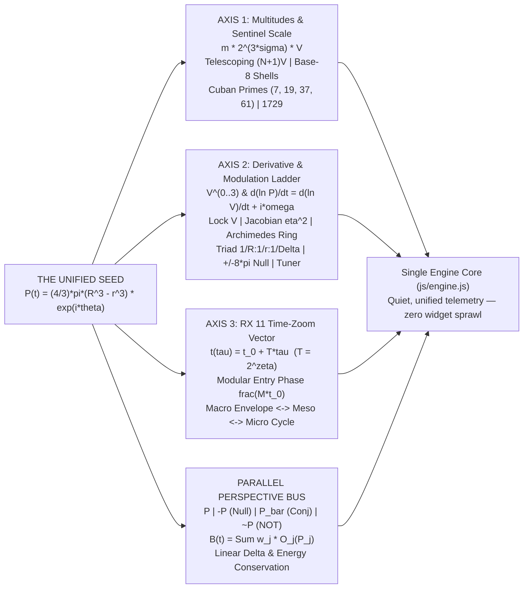

# The Vessel Calculus

### Deriving The Ramanujan Chime from a Single Seed: Derivatives, Multitudes, and Time-Zoom Granularity of $V = \frac{4}{3}\pi(R^3 - r^3)$

> **Thesis.** Just as [`HARMONY_ENGINE.md`](../HARMONY_ENGINE.md) proves that the *Syzygy Twin* and the *Phasor Trace* are two faces of one complex object ($\lambda^k + \bar\lambda^k = 2\,q^{k/2}\cos(k\phi)$), this paper shows that the **radial vessel physics of The Ramanujan Chime** — conserved volume (`Lock V`), the radial Jacobian $\eta^2$, Archimedes' constant-area slice, the Dual-Sphere resonance triad (`OSC A : OSC B : Wall`), the antipodal $\pm 8\pi$ null, Sentinel octave scaling, integer-cube prime & Taxicab locks, and multi-scale time-zoom observation — all descend from **one seed expression**:
>
> $$V(R, r) \;=\; \frac{4}{3}\pi\big(R^3 - r^3\big)$$
>
> Rather than stacking independent formulas, gauges, and alert widgets on top of the instrument, every radial state and modulation across arbitrary scales is governed by three orthogonal operations on that single seed:
> 1. **Derivatives** of $V$ (spatial $\partial_R, \partial_r$ and unit-time $\dot{V}/V$),
> 2. **Multitudes** of $V$ ($2V, 3V, \dots, (N+1)V$ and base-8 Sentinel shells $d_\sigma \cdot 8^\sigma V_0$), and
> 3. **Observer Time-Zoom** ($t(\tau) = t_0 + T\tau$, RX 11-style granularity — distinct from audio time-stretch).

---

## 0. Notation and Conventions

| Symbol | Definition | Role in The Ramanujan Chime |
| :--- | :--- | :--- |
| $V_0$ | $\frac{4}{3}\pi$ | Unit-sphere volume quantum (`R = 1, r = 0`). |
| $V(R, r)$ | $\frac{4}{3}\pi(R^3 - r^3) = V_0(R^3 - r^3)$ | Hollow-sphere carrier vessel (`Engine.shellMetrics`). |
| $v$ | $R^3 - r^3 = V / V_0$ | Dimensionless cubic volume count (integer when $R, r \in \mathbb{Z}$). |
| $\eta$ | $r / R \in [0, 1)$ | Cavity-to-carrier radius ratio (`0` = solid ball, $\to 1$ = thin shell). |
| $\alpha$ | $R / r = 1/\eta$ | Dual-Sphere pitch / time-stretch ratio (`OSC B / OSC A`). |
| $\Delta$ | $R - r = R(1 - \eta)$ | Shell wall thickness (`Wall` mode $\propto 1/\Delta$). |
| $\sigma$ | $\mathbb{Z}$ | Unseen Sentinel radius octave ($R_{\text{sent}} = R \cdot 2^\sigma$, volume $\times 8^\sigma$). |
| $m$ | $\mathbb{Z}_{>0}$ (or $N + 1$) | Volume multitude ($mV$ stacked or composite vessel). |
| $(t_0, T)$ | $t(\tau) = t_0 + T\tau,\;\tau \in [0, 1]$ | RX 11 observer time-zoom window ($T = 2^\zeta$, granularity without stretching). |
| $\Lambda_{\text{obs}}$ | `max_observable_cycles` (`SAMPLES / 2`) | Subjective observer horizon (*The Edge to Infinity*). |

All numeric evaluations in the Chime execute through the single `float32` (`Math.fround`) and `BigInt` core in [`js/engine.js`](../js/engine.js).

---

## 1. The Spatial Derivative Ladder of $V = \frac{4}{3}\pi(R^3 - r^3)$

Treat $V(R, r) = \frac{4}{3}\pi(R^3 - r^3)$ as the **natural resonance potential** of the hollow cavity. Taking successive partial derivatives with respect to outer radius $R$ and inner cavity radius $r$ produces a closed four-rung ladder that terminates cleanly at order 4:

| Order | Exact Derivative | Generated Invariant in The Ramanujan Chime |
| :--- | :--- | :--- |
| **0th** | $V = \frac{4}{3}\pi(R^3 - r^3)$ | **Conserved Shell Energy (`Lock V`):** Holding $V = V_0 R_0^3$ defines the isochoric manifold $R(r) = (r^3 + R_0^3)^{1/3}$. |
| **1st** | $\partial_R V = 4\pi R^2,\quad \partial_r V = -4\pi r^2$ | **Boundary Flux, Jacobian $\eta^2$, and Archimedes' Ring:** Surface areas $A_{\text{out}}, -A_{\text{in}}$; isochoric rate $dR/dr\|_V = \eta^2$; uniform-shift derivative $(\partial_R + \partial_r)V = 4\,A_{\text{ring}}$. |
| **2nd** | $\partial_R^2 V = 8\pi R,\quad \partial_r^2 V = -8\pi r$ | **Great Circles, Shell Wall & Full Modal Triad:** Circumferences $2\pi R, 2\pi r$; ratio $\alpha = R/r$; wall thickness $\Delta = R - r$; full Dual-Sphere triad $1/R : 1/r : 1/\Delta$. |
| **3rd** | $\partial_R^3 V = +8\pi,\quad \partial_r^3 V = -8\pi$ | **Pure $\pi$ Carrier & Antipodal Null:** Both radii vanish, leaving $\pm 8\pi$ anchored to `π_f32 = 0x40490FDB`, summing identically to $0$. |
| **4th** | $\partial^4 V \equiv 0$ | **Exact Closure:** Zero higher-order spatial drift. |

### 1.1 Proof of the Key Rungs

1. **Isochoric Jacobian (`Lock V`, 1st derivative):**
   On a constant-volume contour ($dV = 0$):
   $$dV = \frac{\partial V}{\partial R}\,dR + \frac{\partial V}{\partial r}\,dr = 4\pi R^2\,dR - 4\pi r^2\,dr = 0 \quad\Longrightarrow\quad \boxed{\left.\frac{dR}{dr}\right|_{V} = -\frac{\partial_r V}{\partial_R V} = \frac{r^2}{R^2} = \eta^2 = \frac{A_{\text{in}}}{A_{\text{out}}}}$$

2. **Archimedes' Constant-Area Slice Theorem (1st directional derivative):**
   Moving both spheres outward together at fixed wall thickness ($\delta R = \delta r$, directional operator $\partial_R + \partial_r$) gives:
   $$\boxed{(\partial_R + \partial_r)V \;=\; 4\pi(R^2 - r^2) \;=\; 4\,A_{\text{ring}}(z) \qquad (\forall\,|z| \le r)}$$
   where $A_{\text{ring}}(z) = \pi\big((R^2 - z^2) - (r^2 - z^2)\big) = \pi(R^2 - r^2)$ is the constant cross-sectional ring area across the cavity plateau $[-r, +r]$ (`Engine.sphereResonance`).

3. **The Entire Dual-Sphere Resonance Triad from $V^{(2)}$ Alone:**
   Because the mixed partial vanishes ($\partial_R \partial_r V = 0$), the two pure second derivatives carry the outer circumference ($8\pi R$), inner circumference ($-8\pi r$), and their sum carries the wall thickness ($\partial_R^2 V + \partial_r^2 V = 8\pi(R - r) = 8\pi\Delta$). Taking reciprocals yields the exact $\ell = 0$ radial breathing-mode triad (`OSC A : OSC B : Wall`):
   $$\boxed{\frac{8\pi}{\partial_R^2 V} \;:\; \frac{8\pi}{-\partial_r^2 V} \;:\; \frac{8\pi}{\partial_R^2 V + \partial_r^2 V} \;=\; \frac{1}{R} \;:\; \frac{1}{r} \;:\; \frac{1}{R - r} \;=\; k_1^{\text{out}} : k_1^{\text{in}} : k_1^{\text{shell}}}$$
   Meanwhile, the negative ratio of the second derivatives recovers the exact time-stretch / interval ratio:
   $$\alpha \;=\; -\frac{\partial_R^2 V}{\partial_r^2 V} \;=\; \frac{R}{r}$$
   And any **Guitar-Tuner detuning residual** (`detuneCents`) is simply the logarithmic distance of this $V^{(2)}$ ratio from its nearest simple rational lock $p/q$:
   $$\delta_{\text{cents}} \;=\; 1200\log_2\!\left(\frac{\alpha}{p/q}\right)$$

4. **Pure $\pi$ & Antipodal Null (3rd derivative):**
   $$\partial_R^3 V + \partial_r^3 V \;=\; (+8\pi) + (-8\pi) \;=\; 0$$
   Outer carrier and inner cavity separate into an exact antipodal null pair whose magnitude is purely $8\pi$, linking directly to the `float32` $\pi$ anchor (`0x40490FDB`) locked by Ramanujan's $1/\pi$ series at $k = 0$.

---

## 2. Unit-Time Modulations ($\dot{V}/V$), Cubic Perturbation & The Ramanujan Series Link

Factor $V(R, r)$ into **external scale** ($R^3$) and **internal cavity shape** ($1 - \eta^3$):

$$V(R, r) \;=\; \frac{4}{3}\pi\,R^3\,(1 - \eta^3)$$

Taking the natural logarithm separates the three physical layers additively:

$$\ln V \;=\; \underbrace{\ln\!\left(\frac{4}{3}\pi\right)}_{\pi\text{ carrier}} \;+\; \underbrace{3\ln R}_{\text{Scale / Sentinel Clef }\sigma} \;+\; \underbrace{\ln(1 - \eta^3)}_{\text{Cavity Shape / Tuning}}$$

### 2.1 The Master Unit-Time Modulation Equation

Differentiating $\ln V(t)$ with respect to unit time $t \in [0, 1]$ yields **one exact modulation law** governing every continuous deformation $(R(t), r(t))$ of the vessel:

$$\boxed{\frac{\dot{V}(t)}{V(t)} \;=\; 3\,\frac{\dot{R}(t)}{R(t)} \;-\; \frac{3\eta(t)^2}{1 - \eta(t)^3}\,\dot{\eta}(t)}$$

Every dynamical regime in the Chime is a special case of this one identity:

1. **Natural Conserved Resonance (`Lock V`, $\dot{V} \equiv 0$):**
   The two terms cancel identically ($3\dot{R}/R = \frac{3\eta^2}{1-\eta^3}\dot{\eta}$, equivalently $\dot{R} = \eta^2 \dot{r}$). The vessel breathes at constant volume energy while its internal tuning sweeps at instantaneous octave velocity:
   $$\frac{d}{dt}\log_2 \alpha(t) \;=\; -\frac{\dot{\eta}(t)}{\eta(t)\ln 2}$$
2. **Pure Homothetic / Sentinel Scale Drift ($\dot{\eta} \equiv 0$):**
   Only the first term is active:
   $$\frac{\dot{V}}{V} \;=\; 3\,\frac{\dot{R}}{R} \;=\; 3\ln(2)\,\dot{\sigma}$$
   Global scale and pitch shift together while every internal chord ratio (`OSC A : OSC B : Wall`) remains strictly invariant.
3. **Driven / Perturbed Cavity ($\Delta V(t)$):**
   Expanding $V(R_0 + \delta R(t),\, r_0 + \delta r(t))$ around any resting equilibrium $(R_0, r_0)$ **terminates identically at order 3** (zero infinite Taylor remainder):
   $$\Delta V(t) \;=\; \underbrace{4\pi\big(R_0^2\delta R - r_0^2\delta r\big)}_{\text{1st-order linear flux}} \;+\; \underbrace{4\pi\big(R_0\delta R^2 - r_0\delta r^2\big)}_{\text{2nd-order curvature}} \;+\; \underbrace{\frac{4}{3}\pi\big(\delta R^3 - \delta r^3\big)}_{\text{3rd-order self-similar vessel}}$$
   The cubic nonlinear correction is literally a miniature hollow sphere formed by the modulation amplitudes $(\delta R, \delta r)$ themselves.

### 2.2 The Hypergeometric Link to Ramanujan's $1/\pi$ Series

Inverting the constant-volume law $V = \frac{4}{3}\pi R^3(1 - \eta^3) = \frac{4}{3}\pi R_0^3$ for the breathing outer radius $R(\eta)$ produces a classical **hypergeometric series** ${}_1F_0(\tfrac{1}{3};\,;\,\eta^3)$ in the cavity volume fraction $\eta^3 = V_{\text{cavity}} / V_{\text{outer}}$:

$$\boxed{R(\eta) \;=\; R_0\big(1 - \eta^3\big)^{-1/3} \;=\; R_0 \sum_{k=0}^{\infty} \frac{(1/3)_k}{k!}\,\eta^{3k} \;=\; R_0\left(1 + \frac{1}{3}\eta^3 + \frac{2}{9}\eta^6 + \frac{14}{81}\eta^9 + \dots\right)}$$

where $(a)_k = a(a+1)\cdots(a+k-1)$ is the rising Pochhammer symbol — the same hypergeometric building block underlying Ramanujan's 1914 modular $1/\pi$ series (`Engine.ramanujanSeries`). At the Chime's default $\eta = 0.45$ ($\eta^3 = 0.091125$):
- $k = 0..2$ already reaches `1.032220` vs. exact `1.032362` (relative error $\approx 0.014\%$),
- $k = 0..3$ reaches `1.032351` (relative error $\approx 0.001\%$),
- matching Ramanujan's design philosophy: **one compact anchor state plus rapidly decaying corrections**, rather than disconnected meters.

---

## 3. Multitudes of $V$: Telescoping $(N+1)V$, Base-8 Sentinel Shells, Cuban Primes & `1729`

Derivatives look *inside* a single vessel $V$. **Multitudes** ($2V, 3V, \dots, mV$, up to $(N+1)V$ for immense prime chimes) build *outward* from the exact same seed.

### 3.1 Telescoping Equal-Volume Shells & Duality with $\partial_R V$

Stack $m = N + 1$ concentric hollow shells of equal volume $V_0 = \frac{4}{3}\pi$ ($r_0 < r_1 < \dots < r_m$):

$$\sum_{k=1}^{m} \frac{4}{3}\pi\big(r_k^3 - r_{k-1}^3\big) \;=\; \frac{4}{3}\pi\big(r_m^3 - r_0^3\big) \;=\; m V_0, \qquad r_k \;=\; \big(r_0^3 + k\big)^{1/3}$$

- All internal boundaries telescope cleanly, leaving one outer-minus-inner vessel.
- Stepping from $N \cdot V_0$ to $(N + 1) \cdot V_0$ adds a skin of thickness:
  $$\Delta_m = r_m - r_{m-1} \approx \frac{1}{3 r_m^2} = \frac{V_0}{\partial_R V}\Big|_{r_m}$$
  Thus **discrete $+1V$ multitude addition** and the **1st spatial derivative $\partial_R V = 4\pi R^2$** are exact inverses of each other.

### 3.2 Base-8 (Octal) Sentinel Volume Shells & The `secp256k1` Vessel

Under our dyadic Sentinel register (`Engine.sentinelRegister`), stepping radius by $+1$ octave ($R \mapsto 2R$, shifting only the `float32` exponent with **0-bit mantissa drift**) multiplies volume by **$2^3 = 8$**.

Therefore, **base-8 is the native volume radix of the Sentinel hierarchy**:
- Between Sentinel octave $\sigma$ and $\sigma + 1$, local multitudes **$1V, 2V, 3V, 4V, 5V, 6V, 7V$** (or balanced signed shells $d_\sigma \in \{-4, \dots, +4\}$, where negative terms are nested inner cavities) fill the exact 3-bit cubic span.
- Any enormous integer multitude $M \cdot V_0$ decomposes uniquely across concentric Sentinel octaves:
  $$M \cdot V_0 \;=\; \sum_{\sigma \ge 0} d_\sigma \cdot \big(8^\sigma V_0\big)$$

**Worked Example — `secp256k1`'s 256-Bit Prime Field Order:**
The prime already living in Tab 3 (`Frobenius`) of [`js/engine.js`](../js/engine.js) is:
$$p_{\text{secp256k1}} \;=\; 2^{256} - 2^{32} - 977$$
Writing $256 = 3 \cdot 85 + 1$ gives $2^{256} = 2 \cdot (2^{85})^3 = 2 \cdot 8^{85}$. In Vessel Calculus, $p_{\text{secp256k1}} \cdot V_0$ is literally:
- a **$2V$ outer vessel at Sentinel radius octave $\sigma = 85$**,
- minus a nested **inner cavity** of volume $2^{32} + 977$ (cavity radius ratio $\eta = r/R = \big((2^{32}+977)/2^{256}\big)^{1/3} \approx 2^{-224/3} \approx 2^{-74.67}$)!

### 3.3 Integer-Cube Factorization, Cuban Primes, and Taxicab `1729`

Factor the normalized volume count $v = R^3 - r^3$:

$$\boxed{R^3 - r^3 \;=\; \underbrace{(R - r)}_{\text{Shell Wall }\Delta} \cdot \underbrace{(R^2 + Rr + r^2)}_{\text{Hexagonal / Eisenstein Norm}}}$$

**Unit-Wall Prime Theorem.** For positive integers $R > r \ge 1$, both factors are positive integers, so $v = R^3 - r^3$ can be prime **only when shell wall thickness $\Delta = R - r = 1$**:

$$P \;=\; (r + 1)^3 - r^3 \;=\; 3r^2 + 3r + 1 \qquad (\text{Cuban primes / centered hexagonal numbers})$$

This single condition immediately hits the exact landmark primes of The Ramanujan Chime:
- $r = 1, R = 2 \implies 2^3 - 1^3 = \mathbf{7}$ (the curve constant $b = 7$ in `secp256k1`'s $y^2 = x^3 + 7$),
- $r = 2, R = 3 \implies 3^3 - 2^3 = \mathbf{19}$ (the Chime's default `Order N = 19`!),
- $r = 3, R = 4 \implies 4^3 - 3^3 = \mathbf{37}$,
- $r = 4, R = 5 \implies 5^3 - 4^3 = \mathbf{61}$ (highest prime inside the Order-$N$ slider range `[5..64]`),
- $r = 6, R = 7 \implies 7^3 - 6^3 = \mathbf{127} = 2^7 - 1$ (simultaneously a Cuban prime and a Mersenne prime!).

**Ramanujan's Taxicab `1729` Hollow-Sphere Isomorphisms:**
1. **Product of two unit-wall shells:**
   $$1729 \;=\; 19 \times 91 \;=\; (3^3 - 2^3)(6^3 - 5^3) \qquad (\text{with } 91 = 6^3 - 5^3 = 4^3 + 3^3)$$
2. **Isochoric (`Lock V`) twin vessels:**
   Rearranging $12^3 + 1^3 = 10^3 + 9^3 = 1729$ gives the exact difference-of-cubes identity $12^3 - 10^3 = 9^3 - 1^3 = 728$. Normalized by $12$ into the Unit Vessel ($R \le 1$):
   - **Thin Shell A:** $R_A = 1.00,\quad r_A = \frac{5}{6} \approx 0.8333$
   - **Thick Core B:** $R_B = \frac{3}{4} = 0.75,\quad r_B = \frac{1}{12} \approx 0.0833$
   - **Identical Conserved Volume:** $V_A = V_B = \frac{4}{3}\pi \cdot \frac{728}{1728} = \frac{4}{3}\pi \cdot \frac{91}{216}$

> **Honest Mathematical Boundary.** Only Cuban primes ($3r^2 + 3r + 1$) equal a single *integer*-radius difference $R^3 - r^3$. An arbitrary huge prime $P$ still lives cleanly inside Vessel Calculus either via continuous `Lock V` radius $R = (r^3 + P)^{1/3}$ or as a sparse signed Sentinel-shell sum $\sum d_\sigma 8^\sigma V_0$ (as with `secp256k1` above), snapping to an integer-radius lock (`★`) specifically when $P$ lies on the cubic lattice.

---

## 4. RX 11 Time-Zoom ($T$) as an Expression Vector

A critical physical distinction separates **modifying the chime** from **changing the observer's temporal granularity**:

| Control | Transform | What Changes | Physical Meaning |
| :--- | :--- | :--- | :--- |
| **Audio Time-Stretch** (`Stretch`, $\alpha = R/r$) | $f(t) \mapsto f(t/\alpha)$ or $\sigma_{\text{env}} \mapsto \alpha\sigma_{\text{env}}$ | **The signal itself** (pitch, duration, wavelet width). | Alters how fast or wide the chime physically rings. |
| **RX 11 Time-Zoom** (`Zoom T`, observer window) | $t(\tau) = t_0 + T\tau,\quad \tau \in [0, 1]$ | **Only the observation window** $[t_0, t_0 + T]$. | The giant $(N+1)V$ chime rings untouched; the observer slides granularity $T = 2^\zeta$ across unit viewport time $\tau$. |

### 4.1 Exact Modular Entry Phase (Zero `float32` Collapse at Giant Primes)

For any harmonic or prime frequency $M$ (even a 256-bit `BigInt`!) observed through time-zoom window $t(\tau) = t_0 + T\tau$:

$$\boxed{\phi(\tau) \;=\; \underbrace{\text{frac}(M \cdot t_0)}_{\text{Exact modular entry phase (Coda ROTR)}} \;+\; \underbrace{(M \cdot T)}_{\text{Effective cycles in view}}\,\tau}$$

- Reducing $M \cdot t_0 \pmod 1$ in exact arithmetic *before* entering `float32` prevents catastrophic mantissa cancellation (naive `float64` multiplication of $2^{256} \times t_0$ destroys all fractional phase bits).
- Zooming $T$ down to $2^{-256}$ renders **one single cycle** of a 256-bit prime across $\tau \in [0, 1]$ at full 24-bit `float32` smoothness — using the exact same master formula!

### 4.2 Scale-Space Regimes Across $T$ (Same Master Formula)

Expanding the vessel state $V(t_0 + T\tau)$ around anchor time $t_0$:

$$V(t_0 + T\tau) \;=\; V(t_0) \;+\; \big(T\,\dot{V}(t_0)\big)\tau \;+\; \frac{1}{2}\big(T^2\,\ddot{V}(t_0)\big)\tau^2 + \dots$$

Sweeping $T$ cleanly traverses three perceptual regimes without altering the underlying chime:

1. **Macro Zoom ($M \cdot T > \Lambda_{\text{obs}}$, beyond *The Edge to Infinity*):**
   Fast micro-cycles exceed the observer's spatial Nyquist (`max_observable_cycles`) and coarse-grain into the **macro volume multitude $mV$**, smooth amplitude envelope, and slow `lcm` Round closures — just as RX 11 collapses dense audio samples into an envelope waveform at `12s`.
2. **Meso Zoom ($M \cdot T \sim 1 \dots 10^2$):**
   Standard quadrature trajectories, Dual-Sphere triad (`OSC A : OSC B : Wall`), and clockwork gear clicks (`gcd > 1`).
3. **Micro Zoom ($T \ll 1/f_{\text{slow}}$):**
   Slow vessel drift flattens into a crisp linear tangent $T\,\dot{V}(t_0)\tau$, while fine structure — a single $-1$ prime phase deficit, a single $+1V$ shell step, or Weierstrass micro-ripples — fills the entire unit viewport $\tau \in [0, 1]$ at full `float32` resolution, just as RX 11 reveals individual PCM sample dots at `16ms`.

---

## 5. Parallel Sends, Perspective Operators (`P / P̄ / −P / ~P`), and Master-Bus Coherence

Promoting a vessel multitude $V$ into an oriented state $\mathcal{P}$ closes the loop between **this paper** (radial vessel calculus) and **[`HARMONY_ENGINE.md`](../HARMONY_ENGINE.md)** (complex phasors and twins) — and turns the seed equation into an exact **parallel-processing bus architecture**.

### 5.1 The Seed Is Already a Parallel Differential Bus

Look again at the seed equation itself:

$$V(R, r) \;=\; \frac{4}{3}\pi\big(R^3 - r^3\big) \;=\; \underbrace{+\frac{4}{3}\pi R^3}_{\text{Send 1: Outer Carrier } (+P)} \;+\; \underbrace{\left(-\frac{4}{3}\pi r^3\right)}_{\text{Send 2: Inverted Cavity } (-P)}$$

Even before adding external tracks, the hollow sphere is already a **two-send differential bus**:
- When $r = R$, the two sends cancel identically ($V = 0$, exact audio polarity null).
- When $r = 0$, the inverted send is muted, leaving the dry solid sphere $V_{\text{out}}$.
- When $0 < r < R$, the hollow shell $V$ is the surviving **master-bus residual** — and equivalently the **complement (`NOT`)** of the inner cavity inside the outer carrier ($V_{\text{in}} + V_{\text{shell}} = V_{\text{out}}$).

### 5.2 The Complexified Seed $\mathcal{P}(t)$ & The Complex-Frequency Law

Pair the hollow vessel volume $V(t)$ with its angular phase $\theta(t)$ into **one unified complex state**:

$$\mathcal{P}(t) \;=\; V(t)\,e^{i\theta(t)} \;=\; \frac{4}{3}\pi\big(R(t)^3 - r(t)^3\big)\,e^{i\theta(t)}$$

Differentiating $\mathcal{P}(t)$ over unit time $t$ and dividing by $\mathcal{P}(t)$ unifies both foundational papers in **one line**:

$$\boxed{\frac{\dot{\mathcal{P}}(t)}{\mathcal{P}(t)} \;=\; \underbrace{\frac{\dot{V}(t)}{V(t)}}_{\substack{\text{Real: Vessel Calculus} \\ 3\frac{\dot{R}}{R} - \frac{3\eta^2}{1-\eta^3}\dot{\eta}}} \;+\; i\,\underbrace{\dot{\theta}(t)}_{\substack{\text{Imag: Harmony Engine} \\ \text{Instantaneous Freq }\omega(t)}}}$$

This is literally the **complex frequency $s = \sigma_{\text{rad}} + i\omega$ of the Laplace transform** (`HARMONY_ENGINE.md`):
- When `Lock V` holds ($\dot{V} = 0$), the real damping/growth rate vanishes ($\text{Re}(s) = 0$) — the chime rings as a **purely conservative, undamped oscillator** on the imaginary axis.
- When the vessel expands or contracts ($\dot{V} \neq 0$), the real part records the exact volumetric breathing / Sentinel scale rate, while the imaginary part records instantaneous angular frequency / tape varispeed.

### 5.3 Amorphous Seed, Coherent Perspectives (`P`, `−P`, `P̄`, `Both`, `~P`)

The four spatial-twin symmetries form the **Klein four-group** $V_4 = \{I, -I, C, -C\}$ acting on the single seed $\mathcal{P} = V e^{i\theta}$:

| Perspective / Send | Operator on $\mathcal{P}$ | Bus Sum / Effect | Role |
| :--- | :--- | :--- | :--- |
| **Main (`P`)** | $I(\mathcal{P}) = +V e^{+i\theta}$ | Dry carrier send | Reference state. |
| **Antipodal Null (`−P`)** | $-I(\mathcal{P}) = -V e^{+i\theta}$ | $\mathcal{P} + (-\mathcal{P}) = 0$ | Exact polarity inversion; summing dry `−P` with modulated wet `P` isolates the pure modulation delta $\Delta \mathcal{P}(t)$. |
| **Conjugate (`P̄`)** | $C(\mathcal{P}) = +V e^{-i\theta}$ | $E_+(\mathcal{P}) = \frac{1}{2}(\mathcal{P} + \overline{\mathcal{P}}) = V\cos\theta$ | Standing-wave real projection (Euler / Morlet / elliptic negation). |
| **Anti-Conjugate (`−P̄`)** | $-C(\mathcal{P}) = -V e^{-i\theta}$ | $E_-(\mathcal{P}) = \frac{1}{2}(\mathcal{P} - \overline{\mathcal{P}}) = iV\sin\theta$ | Pure quadrature / imaginary projection. |
| **Bitwise / Cavity `NOT` (`~P`)** | $\sim P = (2^N - 1) - P$ | $P + (\sim P) = 2^N - 1$ (`1111/F` full vessel) | Complement inside a bounded register or carrier ($V_{\text{in}} + V_{\text{shell}} = V_{\text{out}}$). |

**Why the seed can remain "amorphous" yet harmonically coherent on every observed state:**
1. **Orthogonal Resolution of the Identity:** The Conjugate/Quadrature bus projections satisfy:
   $$E_+^2 = E_+, \qquad E_-^2 = E_-, \qquad E_+ E_- = 0, \qquad E_+ + E_- = I$$
   and conserve total vessel energy identically (Parseval identity):
   $$|E_+ \mathcal{P}|^2 + |E_- \mathcal{P}|^2 \;=\; V(t)^2\cos^2\theta + V(t)^2\sin^2\theta \;=\; V(t)^2 \;=\; |\mathcal{P}(t)|^2$$
   No matter which perspective (`P`, `P̄`, `−P`, `Both`) an observer chooses, they are projecting the exact same underlying seed without losing or double-counting energy.
2. **Exact `+1` Bridge Between `NOT` (`~P`) and `Null` (`−P`):**
   In any $N$-bit discrete register (from the 4-bit orbit `0x0..0xF` to 256-bit BitWave/Frobenius registers):
   $$-P \;\equiv\; (\sim P) + 1 \pmod{2^N} \quad\Longrightarrow\quad \boxed{(-P) - (\sim P) \;\equiv\; +1 \pmod{2^N}}$$
   `P + (~P)` saturates to the full outer vessel (`1111/F`), while `P + (−P)` wraps past the boundary by **one single unit quantum (`+1`)** into exact modular `0` (`Null`) — the exact same `±1` quantum that separates an even Clef carrier $E$ from an adjacent prime $P = E - 1$ and separates $N \cdot V_0$ from $(N + 1)V_0$.

### 5.4 Summing Parallel Modulated Sends Back to One Master Bus & Delta Validity

Split the seed into $K$ parallel sends (like DAW parallel FX buses or `ChimeRack` slots `A..H`), each applying a perspective operator $\mathcal{O}_j \in \{I, -I, C, -C, \sim\}$, weight $w_j$, and independent modulation $(V_j(t), \theta_j(t))$, then sum back onto **one master bus**:

$$\mathcal{B}(t) \;=\; \sum_{j=1}^{K} w_j\,\mathcal{O}_j\big(\mathcal{P}_j(t)\big), \qquad V_{\text{bus}}(t) = |\mathcal{B}(t)|, \qquad \theta_{\text{bus}}(t) = \arg\mathcal{B}(t)$$

**Three Exact Validity & Coherence Laws for the Master Bus:**
1. **Linearity of the Unit-Time Delta (Parallel Processing Equivalence):**
   $$\boxed{\dot{\mathcal{B}}(t) \;=\; \sum_{j=1}^{K} w_j\,\mathcal{O}_j\big(\dot{\mathcal{P}}_j(t)\big) \;=\; \sum_{j=1}^{K} w_j\,\mathcal{O}_j\!\left[\left(\frac{\dot{V}_j}{V_j} + i\dot{\theta}_j\right)\mathcal{P}_j(t)\right]}$$
   Computing modulated deltas independently in parallel across $K$ sends and summing them to one bus produces the **exact** derivative of the summed master vessel — zero order-of-operations drift.
2. **Coherent Collapse to a Single Effective Seed:**
   - **In-phase sends ($\theta_j \equiv \theta_0$):** $V_{\text{bus}} = \sum w_j V_j$ (pure multitude addition $mV$).
   - **Antipodal pair ($\theta_2 = \theta_1 + \pi$, $V_2 = V_1$):** $V_{\text{bus}} = 0$ (exact null).
   - **Conjugate pair ($\theta_2 = -\theta_1$, $V_2 = V_1$):** $V_{\text{bus}} = 2V_1|\cos\theta_1|$ (real standing wave along the $f(x)$ axis).
3. **Exact Validity Domain & Null-Crossing Sentinels:**
   - The normalized master-bus delta $\dot{\mathcal{B}}/\mathcal{B}$ is smooth and finite everywhere except at an **exact bus null $\mathcal{B}(t) = 0$**, where $\dot{\mathcal{B}}/\mathcal{B}$ has a simple pole — corresponding directly to a $\pi$ phase-inversion / polarity zero-crossing (and IEEE-754 sentinel `0x7F800000` / `0x7FC00000` in the `tan()` / Bit Lab regime).
   - In the pure real-vessel limit ($\theta = 0$), a negative summed volume $V_{\text{bus}} < 0$ remains algebraically valid: it simply represents the **polarity-inverted dual vessel** $R^3 - r^3 = -(r^3 - R^3)$ where cavity and carrier swap roles.

---

## 6. The Unified 3-Axis Master Frame & Scope Boundary

### Two Complementary Papers, One Engine
- **[`HARMONY_ENGINE.md`](../HARMONY_ENGINE.md)** establishes the **angular / phase / conjugate** proof: complex phasors $e^{\pm i\theta}$, Frobenius eigenvalues $\lambda^k + \bar\lambda^k$, Morlet atoms, and winding ratios (`n : m : k`, `Order N`, `Phase φ`).
- **This paper (`docs/VESSEL-CALCULUS.md`)** establishes the **radial / volumetric / scale / temporal-granularity** calculus rooted in $V = \frac{4}{3}\pi(R^3 - r^3)$ — and shows via $\mathcal{P}(t) = V(t)e^{i\theta(t)}$ and $\dot{\mathcal{P}}/\mathcal{P} = \dot{V}/V + i\dot{\theta}$ how parallel perspective sends (`P / P̄ / −P / ~P`) sum coherently back to one master bus.

### Mapping to Existing Code in [`js/engine.js`](../js/engine.js)

| Vessel Calculus Axis | Existing Foundations in `js/engine.js` | Next Unification Opportunity |
| :--- | :--- | :--- |
| **Axis 1 (Multitudes & Sentinel)** | `sentinelRegister`, `sentinelHysteresisStep`, `clefFactor`, `pseudoMersenneDecomp` | Add base-8 Sentinel shell decomposition, telescoping $(N+1)V$ helper, and Cuban/Taxicab integer-cube lock detector. |
| **Axis 2 (Derivative Ladder)** | `shellMetrics`, `solveConstantVolumeR`, `sphereResonance`, `nearestHarmonicRatio`, `ramanujanSeries` | Unify into one pure `vesselCalculus(state, playT)` derivation exposing $V^{(0..3)}$, $\dot{V}/V$, and hypergeometric expansion. |
| **Axis 3 (RX 11 Time-Zoom)** | `sampleWindow` (Zoom Lens), `floorZoomSec` / `floorZoomLog` (`6 · Floor WT`) | Lift $(t_0, T = 2^\zeta)$ + `BigInt` modular phase `frac(M * t0)` into a general engine-level time-zoom vector. |
| **Parallel Perspective Bus** | `twinOf`, `playhead`, `ChimeRack` slots `A..H`, `BitWaveFeed` Twin Decompiler | Formalize parallel send summation $\mathcal{B}(t) = \sum w_j \mathcal{O}_j(\mathcal{P}_j)$ & linear bus-delta validation (`B(t) ≠ 0`). |

---

## 7. Open Questions & Edge Cases to Stress-Test Next

Before deciding how (or whether) any of this surfaces in the GUI, the math should be stress-tested against five concrete edge cases:

1. **Boundary Singularities ($\eta \to 0^+$ and $\eta \to 1^-$):**
   - As $\eta \to 0^+$ (solid ball), $\alpha = 1/\eta \to \infty$ while $\dot{\eta}/\eta$ diverges unless guarded.
   - As $\eta \to 1^-$ (zero-thickness shell), $1 - \eta^3 \to 0$ and the tuning sensitivity factor $\frac{3\eta^2}{1 - \eta^3}$ in $\dot{V}/V$ blows up smoothly — matching the physical divergence of the shell wall mode $1/(R - r)$. How should `float32` clamp or report approaching sentinels (`0x7F800000`)?
2. **Exact Bus-Null Zero Crossings ($\mathcal{B}(t) = 0$):**
   When parallel sends cancel momentarily on the master bus ($\mathcal{B}(t) \to 0$), $\dot{\mathcal{B}}(t)$ stays finite and smooth, while $\dot{\mathcal{B}}/\mathcal{B}$ exhibits a $\pi$ phase-flip pole. Separating the **raw delta $\dot{\mathcal{B}}$** (always finite) from the **normalized rate $\dot{\mathcal{B}}/\mathcal{B}$** (sentinel-guarded near $|\mathcal{B}| < \epsilon$) keeps bus telemetry rock-solid across nulls.
3. **Exact Dyadic Representation of Anchor Time $t_0$:**
   To compute $\text{frac}(M \cdot t_0)$ with zero precision loss for 256-bit `BigInt` $M$, $t_0$ should be represented as an exact dyadic rational $t_0 = a / 2^b$ (or `BigInt` numerator/denominator) rather than a naive `float64`.
4. **Closed-Loop Feedback with `ModMatrix` & Formulas:**
   When an LFO or internal formula modulates $R(t)$ or $r(t)$ inside a single frame, computing $\dot{R}, \dot{r}$ analytically (from the known LFO waveform derivative) vs. finite-difference over $\Delta t$ avoids frame-rate dependence and keeps `?static=1` 100% deterministic.
5. **Minimal GUI Expression (Zero Clutter):**
   Resolve how the unified vessel state should present itself quietly — e.g., letting the existing formula/resonance surface reflect live equilibrium vs. modulation rather than adding stacked tuner strips and alert badges.
